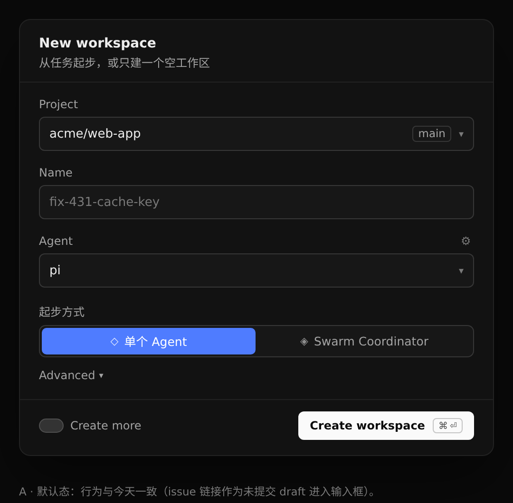
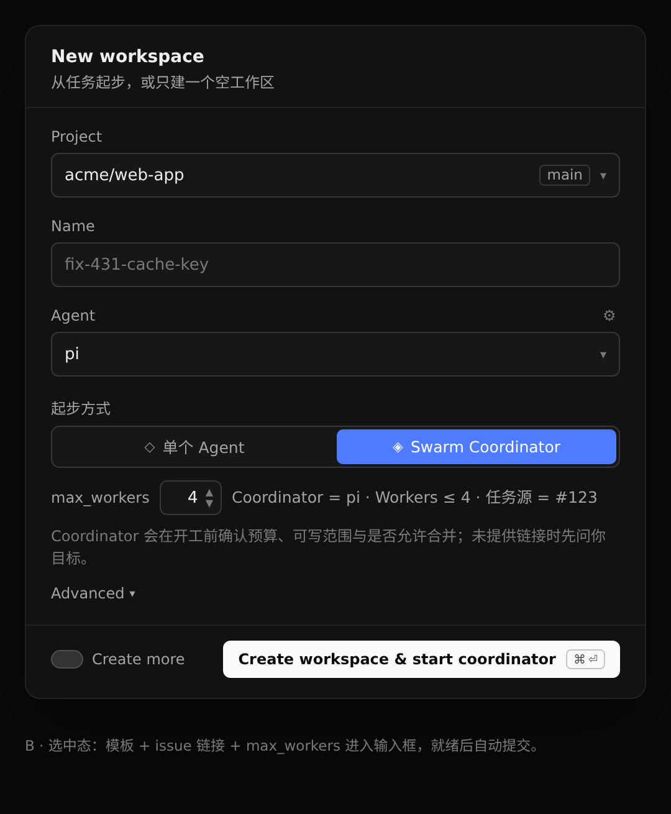

# 新建工作区的「起步方式」：单 Agent / Swarm Coordinator

状态：M1 已在 `orca/` 落地（未部署、未发布）。§1–§9 是设计定稿，§10 记录落地时的
两个决定、与设计的差异和证据层级。本文不授权部署、重启、Agent 启动或费用；
文中数据为脱敏占位（`acme/web-app`、`main`），不含真实主机、运行 ID 与用量。

- 目标问题：从 issue 建工作区后，agent 会起来，但输入框只有 issue 链接且不提交；
  Swarm 起步在这个入口没有选择。
- 相关实现：`orca/renderer` 的新建工作区 composer 与启动投递路径（上游 v1.4.219 快照，
  改动必须窄且有测试）。
- 相关约定：`orca/` 是 public-safe 层，**不得**写入模型清单、profile 文件、host、runtime ID
  等私有值；本文的模板同样只引用仓库内路径，不写私有配置。

## 1. 现状（只读核对过）

从 issue 起步有两条互不相同的路径：

| 入口 | 代码 | 交付方式 |
| --- | --- | --- |
| composer「Start from work item」/ 从 issue 打开新建工作区 | `renderer/src/hooks/composer-state/quick-creation-execution.ts:187` | `promptDelivery = quickDraftPrompt ? 'draft' : 'auto-submit'` |
| 任务页/项目行「Start work」 | `renderer/src/lib/launch-work-item-direct.ts:78` | `promptDelivery ?? 'draft'` |

两条路径的 draft 内容都来自 `renderer/src/lib/linked-work-item-context.ts:180-197`：
GitHub 直接 `return args.url`，Linear 只给 `Linked Linear issue: ABC-123` + URL，均不含正文。
正文快照是另一条链路：建 worktree 后异步 `gh` 抓取一次并写入 `WorktreeMeta.linkedIssueContext`
（`main/github/linked-issue-context-capture.ts:63-118`），只有**后续**在同一个 worktree 里开
agent 时才会被 `renderer/src/lib/linked-issue-context-draft.ts:44-101` 渲染成受控块，
且仍然以 `promptDelivery: 'draft'` 交付。

结论：现在的行为是"起一个 agent + 把链接放进输入框 + 不提交"。这不是缺陷，是
`planLinkedIssueContextLaunch` 注释里写明的取舍（"nothing is submitted on the user's behalf"）。

## 2. 目标与非目标

目标（M1，只在 rebuilt composer 这一条路径）：

1. 新建工作区表单里加一个**起步方式**选择：单个 Agent（默认，行为不变）/ Swarm Coordinator。
2. 选 Swarm 时，初始 prompt 换成一段固定模板 + 当前 issue 链接 + max_workers，
   并把交付方式从 `draft` 改为 `submit-after-ready`（建完即开始对话）。
3. 选择只影响"初始 prompt 与是否提交"，**不**派生任何 Worker 终端，也不读私有 swarm 配置。

非目标（明确不做）：

- 不做配置页/表单化 swarm 参数。Coordinator 当前的形状是"prompt file + 私有 policy"
  （`swarm/coordinator_launch.py:88-115`、`swarm/pi_coordinator.py:93-114`），
  用 trae 形状的表单字段（model/effort/max_mode）去套会引入错误的兼容映射。
- 不把 `max_workers` 之外的策略值写进 UI：预算、可写根、是否允许合并/部署由 Coordinator 反问。
- 不改「Start work」直投路径（`launch-work-item-direct`）；该入口保持 draft，留作后续。
- 不改 `worker-model-profiles.json`，不做"从候选池随机选"的 UI（属 Coordinator 侧行为）。

## 3. 交互设计

### 3.1 选择控件

位置：Agent 选择器之下、`Advanced` 之前（它决定 agent 收到什么，紧邻 agent 更合理）。
形态：两段式分段控件，标签 `单个 Agent` / `Swarm Coordinator`；默认前者，不持久化为全局偏好
（每次建工作区显式选择，避免陈旧策略）。

选中 Swarm 后，在同一区域展开一行参数与一行说明：

| 元素 | 内容 | 说明 |
| --- | --- | --- |
| `max_workers` | 数字输入，默认 4，必须为正整数 | 用户值，不是仓库私有策略；留空则禁用主按钮 |
| 摘要行（只读） | `Coordinator = <所选 agent> · Workers ≤ 4 · 任务源 = issue #123` | 只显示本次解析结果，不显示模型/profile |
| 提示行（muted） | `Coordinator 会在开工前确认预算、可写范围与是否允许合并。` | 让"自动提交"的后果可预期：先问答，不直接开跑 |

### 3.2 初始 prompt（模板）

模板是 renderer 内的 public-safe 常量（无 host、无模型、无 profile 路径），只引用仓库内相对路径：

```text
以 Swarm Coordinator 模式开始工作；先完整读取 swarm/skills/swarm-orchestration/SKILL.md 再动手。
目标：<issue URL>；仓库 <repo 绝对路径>，基线 <base ref>。
max_workers=<N>；含审查、集成、嵌套与讨论用 agent，不另开 Run 绕过该上限。
开工前先把任务源落盘为一个文件（issue 正文 + 本次授权），把路径与 SHA 报给我，并以它作为任务源。
缺预算、可写根、是否允许合并或部署时先问我，不要用默认值。
```

- `issue URL` 只在本次选择带了 work item 时出现；否则写 `目标：见下（未提供链接，开工前问我）`。
- 仓库绝对路径与 base ref 来自表单已有状态（`repoId` 解析出的 path、`baseBranch`），
  不是新增输入。
- 用户若在 note 里写了内容，模板追加在其后，不覆盖。
- 仍然满足"URL 不是任务源"：模板要求 Coordinator 先落盘再开工，`start_grant.py:87-95`
  需要的绝对路径文件由它产出。

### 3.3 交付语义

| 起步方式 | promptDelivery | 结果 |
| --- | --- | --- |
| 单个 Agent | `draft`（现状）或 `auto-submit`（现状，短 prompt 走 argv） | 逐字不变 |
| Swarm Coordinator | `submit-after-ready`（新增到创建工作区请求上） | 首终端就绪后 bracketed paste + Enter |

创建工作区这条链目前的类型只有 `'draft' | 'auto-submit'`
（`renderer/src/lib/pending-worktree-creation.ts:113`），而 `submit-after-ready` 已存在于
新标签页启动路径（`renderer/src/lib/launch-agent-startup-prompt-plan.ts:59-63`）。M1 的做法是
把这一位扩到创建请求上，而不是在创建链里新写一套投递逻辑。

## 4. UI 图

两张图都是 HTML/CSS 渲染的设计稿，不是生产组件渲染、也不是截图；证据层级低于实现渲染。
源文件在本目录 `ui/src/`，用共享脚本
[`docs/design/tools/render-design-mockup.mjs`](../tools/render-design-mockup.mjs) 可重渲染（见脚本头注释）。

**A. 单个 Agent（现状）**



**B. 选中 Swarm Coordinator（新增控件与参数行）**



尺寸 A 540×530、B 540×655（2x 输出 1080×1060 / 1080×1310）。图中 `acme/web-app`、`#123`、`main`、`4` 均为占位值。

版面规则（实现时照此落地，不再逐尺寸调）：

- 分段控件高 32px，`12.5px` 字号；选中态用 `--accent` 实心，未选中为透明描边；
- 参数行与摘要行同为 `13px`，标签 `12px` muted；数字输入宽 64px，右对齐；
- 说明行 `12px` muted，不与错误提示抢位置（错误仍走 footer 的 `createError`）；
- 主按钮文案在 Swarm 下改为 `Create workspace & start coordinator`，仍是 footer 唯一主按钮。

## 5. 数据流

```text
表单(起步方式, max_workers, note, repoId/baseBranch, workItem)
  → quick-creation-execution.ts
      prompt     = 单 agent ? 现有 draft/URL : 模板 + URL + repo/base + max_workers
      delivery   = 单 agent ? 现有 : submit-after-ready
  → buildQuickCreationRequest（新增 promptDelivery 值透传）
  → createWorktree（startup.command / draftPrompt / launchDraftText）
  → 首终端激活 → 就绪 → bracketed paste → Enter
```

`launchDraftText` 仍要设置，否则 native chat 视图拿不到"未发送上下文"的镜像语义
（`renderer/src/lib/worktree-startup-payload.ts:15-40`）。

## 6. 失败与边界

| 情况 | 行为 |
| --- | --- |
| `max_workers` 为空/非正整数 | 主按钮禁用，字段级提示；不发请求 |
| 所选 agent 未被检测到 | 沿用现有 agent 选择逻辑禁用提交（不新增分支） |
| 就绪等待超时（长启动 agent） | 保留 draft + 现有 toast 提示，不静默失败 |
| pi 作为 Coordinator（选 Swarm 且 agent=pi） | 见 §7 风险 1：`submit-after-ready` 会 `forcePaste` 绕过 `ORCA_PI_PREFILL`，必须同时处理 |
| 选择 Swarm 但没有 work item | 允许；模板写"开工前先问我目标"，不猜 issue |

## 7. 风险

1. **pi 的提交可靠性（M1 的硬前置）**。`submit-after-ready` 带 `forcePaste`，会绕过
   `shared/tui-agent-config.ts:133-140` 的 `ORCA_PI_PREFILL` 预填，改走终端就绪检测；
   pi 没有 `draftPasteReadyTimeoutMs` 覆盖，吃默认 8s，而该配置的注释本身就写着
   "paste-after-ready races its long startup"。超时分支是**完全不 paste**
   （`renderer/src/lib/agent-paste-draft.ts:112-117`）。可选做法二选一：
   (a) 保留 prefill，提交改由 pi 扩展在 `session_start` 后按开关发一次；
   (b) 给 pi 补 `draftPasteReadyTimeoutMs`（参照 opencode 的 20s 与测量记录）并把超时降级为 draft。
2. **模板归属**。模板是 renderer 常量，意味着它和仓库内 skill 路径耦合；skill 改名要同步改模板。
   缓解：模板只写一个路径 + 一句"按其执行"，不复制 skill 内容。
3. **`max_workers` 的语义**。它是单 Run 并发上限且含审查/集成/嵌套/讨论 agent；
   用户填 4 却另开一个讨论 agent 即超限。模板里必须带这句，否则值会被误读。
4. **"自动提交"的可预期性**。选 Swarm 后第一轮是 Coordinator 的提问而不是开工；
   UI 说明行必须写清，否则会被当成"点了没反应"。

## 8. 测试计划（实现时）

窄集合，只覆盖本改动：

- `orca`：`NewWorkspaceComposerCard.test.tsx`、`NewWorkspaceComposerCard.start-from.test.tsx`
  （默认单选、选中 Swarm 展开参数行、`max_workers` 校验禁用提交）；
- `orca`：composer-state 的请求构造用例（swarm → prompt 含模板与 URL，delivery 为
  `submit-after-ready`；单 agent → 逐字不变）；
- `orca`：创建链 paste 用例（新 delivery 值确实提交；超时降级为 draft）。
- 不跑全量 vitest；按批次小集合执行并报告批次。`swarm/` 侧无 Python 改动，故不涉及
  `tests/run_blast.sh`。

## 9. 实施清单（窄 diff）

1. `renderer/src/components/NewWorkspaceComposerModal.tsx`：新增 `launchMode` 与
   `maxWorkers` 状态，随 `submitQuick` 下传。
2. `renderer/src/components/new-workspace/NewWorkspaceComposerLaunchModeSection.tsx`（新建）：
   分段控件 + 参数行 + 说明行。仅此一处新组件，不引入抽象层。
3. `renderer/src/components/NewWorkspaceComposerCard.tsx`：在 Agent 与 Advanced 之间插入该分区。
4. `renderer/src/lib/swarm-launch-prompt.ts`（新建）：模板常量与 `buildSwarmLaunchPrompt({...})`。
5. `renderer/src/hooks/composer-state/quick-creation-execution.ts`：按 `launchMode` 选 prompt 与 delivery。
6. `renderer/src/lib/pending-worktree-creation.ts`：`promptDelivery` 增加 `'submit-after-ready'`。
7. 首终端 draft 投递处：新值走 submit；超时降级保持 draft。

不改：`launch-work-item-direct*`、`linked-issue-context-*`、`worktree-startup-payload` 的现有字段语义。

## 10. M1 落地记录

### 10.1 需要先定的两件事：已定

1. **pi 的提交走 (b)，不走 (a)。** (a) 要 pi 在 `session_start` 后自己发一次提交，而 pi 的扩展
   API 里只有 `ctx.ui.setEditorText` 这类 fire-and-forget 方法，没有提交入口；照 (a) 做等于先
   发明一个新 API。因此：`shared/tui-agent-config.ts` 给 pi 补
   `draftPasteReadyTimeoutMs: 20_000`（与 opencode 相同的预算），并把超时降级为"至少留
   draft"——`renderer/src/lib/swarm-launch-prompt-delivery.ts` 在就绪等待失败后以未提交方式
   再 paste 一次，并明确提示"已在输入框、未发送"。
   **这个 20s 是假设，不是 pi 的实测值**（opencode 的 20s 有测量记录，pi 还没有）；pi 上的
   真实成功率仍未验证。
2. **`max_workers` 是表单值（默认 4），不是"开工前问我"。** 模板里同时写值与语义
   （含审查、集成、嵌套与讨论用 agent），所以选完即开工，不需要多一轮问答；字段非正整数时
   主按钮禁用。

### 10.2 与设计的差异

- §5 的 `launchDraftText`：swarm 路径不写"未发送上下文"的 draft 镜像，而是把已提交的首条
  prompt 镜像成 chat 的 prompt 气泡（`deliverLaunchPromptToAgentTab` 的 seed）。理由：这条
  prompt 是**提交**而非留白，draft 镜像会让 GUI 显示一段其实已经发出去的未发送文本。
- 校验与摘要的实现归属：`max_workers` 的解析/门禁在 `lib/swarm-launch-prompt.ts`
  （`parseSwarmMaxWorkers`、`launchModeBlocksCreate`），首条 prompt 与 delivery 的选择在
  `hooks/composer-state/quick-startup-plan.ts`（`buildQuickComposerStartup` 内调用
  `planQuickCreateLaunchPrompt`），因此 `quick-creation-execution.ts` 只多了一次
  `buildQuickComposerStartup` 的入参，没有新增抽象层。
- 新增 `lib/swarm-launch-prompt-delivery.ts`（第 7 项的实现体）：创建链的"首终端投递"原本
  只有 draft paste，提交语义与超时降级需要单独一处可测代码。

### 10.3 证据层级（做到了什么、没做到什么）

已执行（`orca/`，批次小集合，`--maxWorkers=2`）：

- `src/renderer/src/lib/swarm-launch-prompt.test.ts`、`.../swarm-launch-prompt-delivery.test.ts`、
  `src/renderer/src/hooks/composer-state/quick-startup-plan.test.ts`、
  `src/renderer/src/hooks/composer-state/quick-creation-request.test.ts`、
  `src/renderer/src/lib/new-workspace.test.ts`（新增 `submitDraft` 两例）、
  `src/renderer/src/components/new-workspace/NewWorkspaceComposerLaunchModeSection.test.tsx`、
  `src/renderer/src/components/NewWorkspaceComposerCard.launch-mode.test.tsx`；
- 既有回归：`hooks/composer-state`、`components/NewWorkspaceComposer*`、`components/new-workspace`、
  `lib/launch-work-item-direct*`、`lib/agent-paste-draft*`、`components/terminal-pane/pty-connection`、
  `shared/tui-agent-config.test.ts`；
- `tsc -p config/tsconfig.web.json` / `tsconfig.node.json`、`oxlint`、`oxfmt --check`、
  `check-max-lines-ratchet.mjs`、`verify-localization-catalog.mjs`（含 `--fix` 写入 11 个 en 键）、
  `verify-localization-extraction.mjs`、`check-reliability-gates.mjs` 均通过。

**真实组件渲染核对（A8 后半条，一次性证据，未入库）**：用 `tests/e2e` 的 Electron fixture
在 Xvfb 下启动真实应用，打开 rebuilt composer 并截了 4 张图（默认单 agent / 选中 swarm 且
`max_workers=4` / 填 0 的非法态 / 填 6 的合法态）。截图脚本是一次性的，跑完即删，没有作为
回归门禁提交。核对结果：

| 项 | 真实渲染 | 设计稿 |
| --- | --- | --- |
| 位置 | Agent 与 Advanced 之间 | 一致 |
| 默认态 | `单个 Agent` 选中，无 `max_workers`/说明行 | 一致 |
| 选中态 | `max_workers` 输入框（64px、右对齐、默认 4）+ 摘要行 + 说明行 | 一致 |
| 非法态 | 输入框红边 + `Enter a whole number of 1 or more.` + `Workers ≤ —` + 主按钮禁用 | 一致 |
| 选中段填充 | 应用 `--primary` 实心 | 稿里是稿内的 `--accent`（蓝）；应用内 `--accent` 是中性 hover 色，28px 段上用它会读成 hover，故改用 `--primary` |
| 标题 | 跟随 `primaryActionLabel`：swarm 下变成 `Create workspace & start coordinator` | 稿里标题固定 `New workspace`（沿用现状，不改标题逻辑） |
| 摘要行 | 无 agent 标签时（`Blank Terminal`）会折成两行 | 单行；有真实 agent 名时单行 |

**没做**：pi（或其他 agent）在真实终端里 `submit-after-ready` 的成功率与就绪时序；任何 swarm
Run 演练。因此上面的证据只证明"表单能给出正确的指令、并把它交给就绪后的 paste，UI 与设计稿
一致"，不证明任何 Run 能跑起来。

已知与本改动无关的红点：`audit-localization-coverage.mjs --check` 在
`components/right-sidebar/incidents/IncidentDetailDrawer.tsx:131`（`sha256:`）与
`IncidentGrayTables.tsx:186`（`exit`）上失败，两文件本次未修改；本改动自己的 `max_workers`
字样已按技术字面量登记进 `config/localization-coverage-allowlist.json`。
