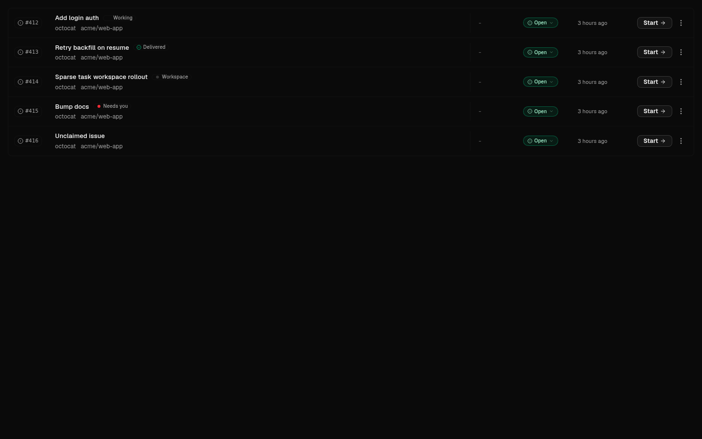
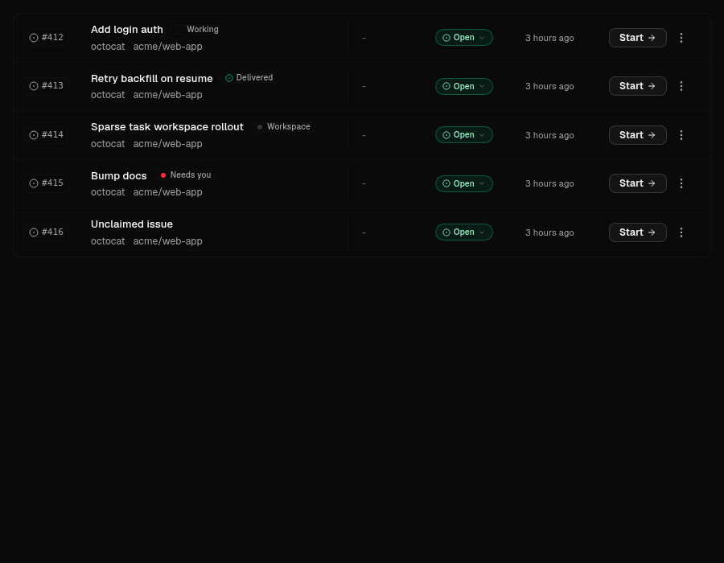
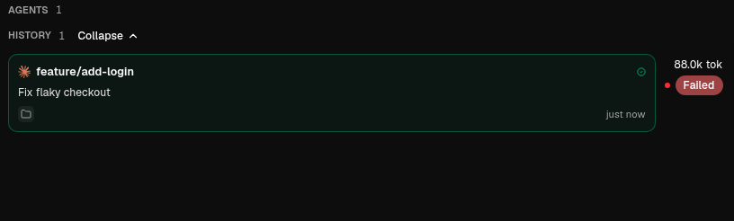
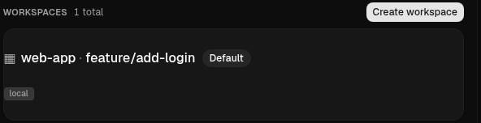
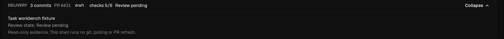
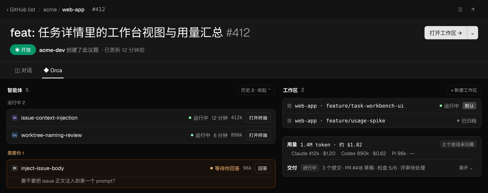

# 以任务为中心的 Tasks tab 改造：调研与 UI 设计

状态：**P1（M1，任务详情 `Orca` tab）已实现并合入 main**，实现范围是 GitHub issue/PR；
**P3（列表主轴）与 P4（`taskRecords` 持久化）未开始**。
调研基线：本仓库的 `orca/` 层（upstream `v1.4.219` 快照，见 `orca/upstream.json`、`orca/UPSTREAM.md`）。
文中 `orca/...` 路径均相对本仓库根目录。
核对日：2026-11-18（重核：P1a/P1b/真实 `Orca` tab 已在 main；新增项目块"Open agent in `<project>`" 入口，
见 §7.9）。

本文只记录"代码里有什么 / 能怎么改"。不修改任何 schema、启动器、已装技能或既有会话；不构成实施、合并、
部署、重启或创建 worktree / Agent 的授权。文中行号与文件路径均为只读观察值，改动前需重新核对 HEAD。

本文遵守本仓库的 [public-repository boundary](../../../AGENTS.md) 与本层约定：不含组织配置、主机名、
真实 Run / Task / terminal ID、部署路径或凭据。

关联：[任务与工作区模型](../task-workspaces.md)（一个任务如何绑定 worktree、如何续做）、
[开发计划](development-plan.md)（阶段、工作包、退出条件与测试矩阵）、
[评审记录](discussion-record.md)（2026-11-09 只读 panel 的结论、缺项与失效条件）、
[工作台 UI 评审记录](discussion-record-task-workspace-ui.md)（2026-11-16 两轮）与对应
[第 1 轮 brief](review-brief-task-workspace-ui.md) / [第 2 轮追问](review-followup-task-workspace-ui-r2.md)。

---

## 1. 结论

**可行。** 但不是"重排 UI"，而是**换掉 Tasks tab 的信息主轴**。

- 四段数据链（任务 ⇄ 工作区、Agent、用量、交付证据）在代码里**基本都已存在**：
  worktree 记住来源任务、Agent 状态存储 + Agent Dashboard、用量扫描按 `worktreeId` 归因、
  PR/checks 已在 PR 页面。
- 唯一真正的空白是**任务身份**：`../task-workspaces.md` 的"未实现"表写明
  "逻辑任务 ID、稳定身份路由"不存在——没有 CLI 参数、没有 schema、没有持久记录。
- **关系存储**（§8）：并非全都要存——运行态/Agent 列表/实时用量是派生；任务实体、绑定集合、用户意图与
  "结算过的用量"必须存，落点是 profile-state 里新增的一个 JSON domain（不需要 DDL、不需要 bump schema 版本）。
- **2026-11-09 只读评审的收敛结论**：M1 可以现在做（3/3 同意）；M2 冻结到 H1（旧 build round-trip）与 H2
  （`ambiguous_session` 频率）有证据为止；逐 Agent 的金额在会话级归因成立前不展示，只显示 token 或"不可用"。
  分歧只在"是否值得为任务历史/多工作区语义承担 M2 成本"，属产品优先级，见[评审记录](discussion-record.md)。
- 实施拆分（工作包、退出条件、测试矩阵、回滚）见[开发计划](development-plan.md)。
- 因此推荐 **增量优先**：先在不新建 schema、不新增 RPC 的前提下，把 join 层做对（决策见 §6，
  UI 见 §7.4），验证归因质量后再决定是否翻列表主轴（§7.2 / §7.3）。

体量参考（用于判断改动成本，不是结论）：`task-page/` 47 个文件 + `use-task-page-*` 48 个 hook；
移动端 `mobile/src/tasks/` 206 个文件；`components/dashboard/` 62 个文件。

---

## 2. 现状：这个 tab 现在是什么

| 事实 | 证据 |
| --- | --- |
| 顶层视图 `TopLevelView = 'terminal' \| 'settings' \| 'tasks' \| 'activity' \| 'automations' \| 'space' \| 'skills' \| 'artifacts' \| 'mobile'` | `orca/src/shared/ui-chrome-types.ts:115` |
| "Tasks" 是**四个 issue provider 的列表页**：GitHub / GitLab / Jira / Linear | `orca/src/renderer/src/components/task-page/{github,gitlab,jira,linear}/` |
| 点条目进全页详情：PR → `PullRequestPage`；issue → `GitHubItemDialog` | `task-page/Content.tsx` |
| issue 详情 tab 只有 `conversation / checks / files`（`files` 仅 PR） | `components/github/github-work-item-identity.ts:54` |
| 详情页**不显示**任何工作区 / Agent / 用量信息 | `task-page/github/IssueDialog.tsx` 全文无 workspace/agent 引用 |
| 只有 Linear 有 `in-orca` 模式（只列已关联工作区的 ticket）；GitHub 无 | `use-task-page-linear-in-orca-effects.ts`、`github/ModeControls.tsx` |
| 已有的"按 Agent 看"的并行入口：Agent Dashboard（实验特性）、Agents feed（Activity） | `components/dashboard/`、`orca/docs/site/content/docs/activity.mdx` |
| 用量只在 Settings → Stats 下，且按 provider 分区，没有任务/工作区维度入口 | `components/stats/*`、`settings/settings-interface-secondary-section-renderers.tsx:110` |

一句话：现在是**tracker 镜像**；想法要的是**本地工作视图**。

---

## 3. 四段数据链就绪度

### 3.1 任务 ⇄ 工作区：已有，双向

| 能力 | 现状 | 位置 |
| --- | --- | --- |
| worktree 记住来源任务 | `linkedIssue`(github) / `linkedLinearIssue` / `linkedGitLabIssue` / `linkedGitLabMR` / `linkedBitbucketPR` / `linkedAzureDevOpsPR` / `linkedGiteaPR` / `linkedWorkItem{provider:'github'\|'gitlab'\|'linear'\|'jira'}` / `linkedTaskSourceContext` | `orca/src/shared/worktree/meta-types.ts:18`、`shared/worktree/types.ts:12` |
| 来源消歧信息 | `TaskSourceContext{provider, projectId, hostId, repoId, providerIdentity, accountLabel}` | `shared/task-source-context.ts` |
| 反查：任务 → 工作区 | GitHub/GitLab：**单条**（取第一个非归档） | `renderer/src/lib/github-work-item-workspace-attachment.ts` |
| 反查：任务 → 工作区（列表） | Linear 有完整索引（含 workspace/org 归一） | `renderer/src/components/task-page-linear-in-orca-issues.ts` |
| 用户已能看到绑定 | worktree 卡片显示关联 Jira/Linear issue | `sidebar/worktree-card-jira-issue-display.test.ts` |
| 任务 sparse 证据 | `sparseTaskBinding{pinnedSha, baseSource, requestedCone, requiredPaths}` | `shared/worktree/sparse-task-binding.ts` |

**缺口**：
- `find*Attachment` 是"取第一个"，要支持"一任务 N 工作区"需升成列表索引（Change: S，影响多处调用点）。
- `linkedWorkItem` 是**快照**（title/url），provider 侧标题/状态变化后不会自动刷新；Linear/GitHub 有结构化字段，相对可靠。

### 3.2 Agent：三种来源齐备

| 来源 | 覆盖 | 位置 |
| --- | --- | --- |
| 活着的 Agent | 状态机（working/blocked/waiting/done/idle）、`model`、`prompt`、last message、子 Agent、子任务 token 上报 | `shared/agent-status-types.ts`、`shared/agent-status-store.ts` |
| 最近结束的 Agent（保留态） | 跨 worktree 的 kanban 卡片，含 `task / lastUserMessage / lastAgentMessage / review` | `components/dashboard/build-dashboard-snapshot.ts`、`shared/dashboard-snapshot.ts` |
| 历史会话（进程已死） | AI Vault 扫描 provider transcript，按 **cwd → worktree** 映射（`current/active/archived/unavailable`），每会话含 `totalTokens`、agent、model、时间窗 | `renderer/src/components/right-sidebar/ai-vault-session-worktree.ts`、`main/ai-vault/session-scanner-types.ts:120` |
| Agent ↔ provider session 精确 join | 状态行携带 `providerSession{key,id,transcriptPath}` | `shared/agent-session-resume.ts:34`、`agent-status-types.ts:157` |
| 子 Agent 自己的 token | 子任务行上报 `totalTokens` | `shared/agent-child-row-model.ts:66`、`shared/agent-status-child-work-evidence.ts` |

**缺口**：缺少统一的 join 层（worktree → 当前/历史 Agent 行），以及"谁是主 Agent"的判定规则。

### 3.3 消耗资源：聚合已算好，未暴露到任务维度（关键发现）

| 事实 | 证据 |
| --- | --- |
| 主进程按 `worktreeId + sessionId + model + day` 统一 rollup（Claude/Codex/OpenCode/Muse） | `main/usage/usage-rollup-records.ts`、`usage-event-aggregation.ts` |
| 归因 key = `worktree:<id>`；label = **worktree 显示名** | `main/usage/usage-event-attribution.ts:39-45` |
| `projectBreakdown[].key` 就是 `worktree:<id>`，且带 `estimatedCostUsd` | `main/claude-usage/claude-usage-report-aggregation.ts:121`、`shared/claude-usage-types.ts:39` |
| 渲染进程**今天就能读到**按 worktree 的聚合（`claudeUsageProjectBreakdown` 等） | `renderer/src/store/slices/`（`*UsageProjectBreakdown`）、`components/stats/ClaudeUsagePane.tsx:56` |
| 单会话归因已有成熟算法：sessionId 精确 → 否则 worktree + 时间窗；多重命中判 `ambiguous`，无命中判 `no_matching_session`，远端判 `remote_usage_unavailable`，**未知不记 0** | `main/automations/run-usage-collection.ts`、`main/claude-usage/claude-usage-automation-attribution.ts:48-91` |
| "按对象汇总用量"的既有范式（known/unavailable 计数） | `shared/automation-usage-summary.ts` |
| 计价口径 | 各家 `estimatedCostUsd`；Codex 有 `hasUnpricedModels` 标记未定价模型 |

**缺口**：
- 对外 session 行类型**没有 `worktreeId`**（`ClaudeUsageSessionRow` 只有 `projectLabel`），按会话归因需加 additive 字段（并处理 RPC catalog / wire 兼容）。
- **用量扫描默认关闭**（`main/claude-usage/store.ts:42` `enabled: false`）——多数用户首次打开会是空态。这是产品决策，不是缺陷。
- 移动端 / 配对客户端**没有任何 token 用量 RPC**（只有账号配额 `accounts` family）。

### 3.4 任务身份：唯一空白

`../task-workspaces.md` 明确：逻辑任务 ID 与跨入口路由不存在；"一任务多仓库绑定"不存在
（`software-development-v1` 任务记录只允许单值 `repository`）。

三条可选身份来源：

| 方案 | 定义 | 覆盖 | 成本 | 风险 |
| --- | --- | --- | --- | --- |
| A. tracker 身份 | `provider + project/repo + number`（`TaskProviderIdentity` 已存在） | 只有来自 tracker 的任务 | 零 schema | 排除"聊着就干了"的常见用法 |
| B. 工作区身份 | 一个专属 worktree = 一个任务（与 sparse task workspace 的隔离单位定义一致） | 全量 | 零 schema | "一任务两工作区"退化为两个任务 |
| C. 本地逻辑任务记录 | 新增持久任务记录 + 绑定集合 | 全量且正确 | 最高（跨 runtime ID 不能混用） | 与设计文档 §对象与关系 强耦合，需单独评审 |

**建议**：A + B 混合的**渲染层投影**（不落库），把 C 留作后置：

```text
taskKey = "provider:github:repo-17:#412"   // 有 tracker
taskKey = "workspace:web-app::feature/add-login"  // 无 tracker（本地任务，标题取 worktree displayName）
```

实现口径（issue #38 起，`orca/src/renderer/src/lib/task-workbench/task-workbench-identity.ts`）：
条目身份是 `TaskWorkbenchItem {type: 'issue' | 'pr', number}`，追加在 repo 级 key 之后，即
`tracker:github:acme/web-app:issue:412`；repo 段仍由 `taskProviderIdentityCachePart` 单一实现产出。
条目级 key 只用于**命名**：某任务的 workspace 集合由 `worktreeLinksTaskItem` 逐个 worktree 判定
（`linkedIssue` / `linkedPR` / `linkedWorkItem`，叠加 worktree 记录过时的 provider/host 校验），
零匹配就是零。`resolveTaskIdentity` 不再返回 matched ids——把 repo 级 key 当成集合来源正是该 bug。

投影意味着"分组/排序/合计"都从既有 store 现算，**不新增持久化契约**；代价是跨窗口/跨端不共享，
跨入口续做仍需读 worktree 绑定（与现状一致）。

---

## 4. 可行性矩阵

| 设计元素 | 现状 | 缺口 | 量级 |
| --- | --- | --- | --- |
| 跨 provider 统一任务列表 | 四家各自列表 + 分页 + 缓存 | 需要一个投影层；跨宿主要带 host 维度 | M |
| 点开看到完成它的 Agent | 三种来源齐备 | join 层 + 主 Agent 判定 | S–M |
| Agent 的 model / 状态 / 消息 | 已有 | 无 | S |
| Agent 的 token / 花费 | 已有（会话级 + worktree 级） | session 行缺 `worktreeId`；歧义态表达 | S |
| 任务级合计花费 | 已有（`worktree:<id>`） | "未启用/未知/远端不可用"三态 | S |
| 工作区 / 分支 / 基线 / 脏状态 | 已有（含 sparse 回执） | 列表反查 | S |
| 交付证据（PR / checks / review） | 已有 | 任务级聚合视图 | M |
| 桌面端 | 可做 | — | — |
| 移动端 / 配对 / Web | 任务详情是另一套实现 | 新 RPC + allowlist + 录制 golden + wire 兼容 | L |
| SSH / 远端用量 | 明确不可用 | 只显示"不可用"，或等 host 侧发布 | L（不建议一期） |

---

## 5. 与既有视图的分工（必须先写清，否则三个页面互抢入口）

| 视图 | 回答的问题 | 粒度 |
| --- | --- | --- |
| **Tasks**（改造后） | "这个任务做到哪了？谁在做？花了多少？" | 任务 → 工作区 → Agent |
| **Agent Dashboard**（实验） | "现在有哪些 Agent 需要我？" | Agent 卡片（跨 worktree） |
| **Agents feed / Activity** | "我刚离开这段时间发生了什么？" | 事件流（时间序） |
| **AI Vault** | "某次会话当时聊了什么？" | 单个 provider 会话 |
| **Settings → Stats** | "我这周总体花了多少？" | provider / 模型 / 工作区聚合 |

改造后 Tasks 只做**任务维度的 join 与汇总**，不复制 Agent 的实时控制面，也不复制事件流。

---

## 6. 需先拍板的 6 个决策

| # | 决策 | 建议 | 不定的后果 |
| --- | --- | --- | --- |
| D1 | 任务身份（§3.4 A/B/C） | A+B 渲染层投影，C 后置 | 无法定义"点开的是哪个任务" |
| D2 | 用量默认关闭怎么办 | 面板显示"未启用"CTA，并**不**改默认值 | 改默认值涉及隐私面，不能顺手做 |
| D3 | 一任务多工作区的主/次 | worktree 新增显式 primary 语义（投影里也可先用"最近活动"代） | 现有代码处处"取第一个" |
| D4 | 无 tracker 的本地任务进不进列表 | 进；**R1 已修订**：不是独立分组，而是 `◇` 徽标 + 顶部筛选 | 最常见的用法被排除 |
| D5 | 移动端一期做不做 | 不做，明确"桌面独有"并登记 parity 豁免 | 跨端契约门禁会持续报差异 |
| D6 | 关系存哪（§8） | 派生不存；provenance 留既有字段；任务实体进 `taskRecords` domain | 变成"只有投影"，手动组织与历史成本全丢 |

### 6.1 评审后修正（2026-11-09）

下表来源列的 A/B/C 指 2026-11-09 的三位评审者；2026-11-16 的两位评审直接以 agent 名标注
（codex-ark / trae）。

| # | 修正 | 来源 |
| --- | --- | --- |
| R1 | `Unlinked` 从分组降为**徽标/筛选器**（`◇`）；分组只保留运行/交付状态，并定义互斥优先级 | A |
| R2 | 逐 Agent 只显示 **token**，金额只出现在工作区级与任务级；会话级归因未成立前不显示金额 | A、C |
| R3 | 图 B 默认折叠历史 Agent、次要工作区与 Delivery/Evidence | A |
| R4 | M1 的 selector 必须可被 M2 直接复用，否则暂停并重新拆包 | A、B |
| R5 | M2 拆为 `M2a 存储兼容验证` + `M2b 落库实现`；M2a 不过就只交付 M1 | B |
| R6 | M1 的对照数据要覆盖 OpenCode 与 Muse，不只 Claude/Codex | C |
| R7 | `projectBreakdown.key` 必须经解析层 + 单测，不直接散落 `split(':')` | C |

`Delivered` 的产品定义已于 2026-11-16 由产品 owner 定为 **agent done**（D12，完整规则见 §7.2）；
分组优先级（`Needs you > Working > Delivered`）与归属规则同步冻结，遗留只有"失败轮是否算"一项。
D12 是本文最后一个决策编号，空号不复用。

### 6.2 评审后修正（2026-11-16，任务工作台 UI 两轮）

对象：§7.1 IA、§7.2 列表主轴、§7.3 图 B 工作台。两轮独立评审（codex-ark / trae）；第二轮只追问 4 个能改变
决定的点，两份稿见 [评审记录](discussion-record-task-workspace-ui.md)。

**能冻结（现在定）**

| 项 | 取值 |
| --- | --- |
| IA 主轴 | "任务 → 工作区(0..N) → Agent → 用量 → 交付证据"成立，不再推翻 |
| 一期形态 | M1 = 现有 issue/PR 详情加 `Orca` tab（§7.4），零持久化 |
| 分组规则 | 按**活跃（非归档）工作区状态并集**判定，不按 primary；0 工作区 / 无 tracker / 归档见 §7.2 |
| 侧栏 | **不加任务行**；只保留工作区行 + 任务徽标（两评一致） |
| 降级顺序 | §7.3.1（先牺牲 Delivery，再 Agent 历史，最后 Spend 细节；Workspaces 身份与 CTA 不牺牲） |
| selector 合同 | identity / join / usage 三件套必须可被 M2b 直接复用（R4），不在页面内拼装 |
| `Delivered` 定义 | **agent done**（D12，§7.2）：忽略 `sessionBoundary`，`failure/cancellation` 不计入；语义是"这一轮做完了"，不是验收通过 |

**不能冻结（现在保留为开放项）**

| 项 | 原因 |
| --- | --- |
| 图 B 的三区像素布局与折叠细节 | 无任何真机渲染证据（§12）；两评都判这是最大返工区 |
| 入口位置（点列表行 vs issue 详情 tab） | M1 与 M2b 必然不同，现在定就是自缚 |
| 任务头部字段（目标/验收/授权/owner） | M1 取不到；见下条 |
| 显式 primary | 需要持久化语义，属 M2b |

**任务意图层（两轮最大发现）**：工作台真正缺的一层是"任务目标/验收/授权/owner"。M1 只能从现有数据取到
弱信号：tracker 标题与 body、PR `checksSummary/reviewDecision/mergeable`、`sparseTaskBinding.requiredPaths`、
`linkedTaskSourceContext`；取不到的是显式验收标准、任务 owner、授权人。因此 **M1 在文案与命名上只能做
"任务聚合视图"，不得承诺完整任务对象**；两者分歧仅在此：A 认为可保留"工作台"名称仅限缩文案，B 认为
必须改名。本文取保守口径（B），M2b 有 `taskRecords` 后再叫"任务工作台"。

---

## 7. UI 设计

设计语言遵循 `orca/docs/STYLEGUIDE.md`：只用 `components/ui/` 既有 primitive（`card` `badge` `tabs`
`collapsible` `sheet` `hover-card` `tooltip` `progress` `separator`），不新增色值/字号/阴影层级；
状态 glyph 复用 Agent 既有语义（spinner=working、amber=needs you、emerald=done、red=blocked、gray=idle）。

线框图里的界面文案用英文（Orca 默认 UI 语言为英文，zh/ja/ko 走 locale catalog）；实现时所有文案都必须
进 catalog，不能把图里的字符串直接写死。`⚑` 表示折叠的子 Agent 组。

### 7.1 信息架构

```text
Tasks (top level view)
├── 工具条：provider 过滤 · 搜索 · 分组切换（Task / Provider）
├── 列表（分组）
│   ├── Needs you        ← 关联 Agent 里有 blocked/waiting
│   ├── Working          ← 有 working 的 Agent
│   └── Delivered        ← agent done（D12；不等于验收通过）
│   （`◇` 无 tracker 是行内徽标 + 顶部筛选，不是第 4 个分组，见 §6.1 R1）
└── 详情（点开列表行）
    ├── 头部：标题 · provider · 状态 · 主工作区/分支 · 基线 SHA · PR 缩略
    ├── 左：Agents（活 / 保留 / 历史，可折叠子 Agent）
    ├── 右：Workspaces（0..N） · Spend（用量）
    └── 底：Delivery（commits/PR/checks/review） · Evidence（binding / 会话链接）
```

列表页不承担建单：建任务仍走各 provider 的 `＋ New issue` 表单，或让 agent 在会话里用既有 tracker
skills / CLI 动词建单。

### 7.2 图 A：任务列表（方案 2 形态）

```text
┌───────────────────────────────────────────────────────────────────────────────────────────┐
│  Tasks                              [ All providers ▾ ]   [ Search…        ]   ⌘F         │
│  ◉ Needs you 3    ◐ Working 4    ✓ Delivered 12   ◇ No tracker 5  [ Tracker: all ▾ ]      │
├───────────────────────────────────────────────────────────────────────────────────────────┤
│  NEEDS YOU                                                                                │
│  ◉  Add login auth                    GitHub #412    ▦ 2 ws   ⚑ 2 agents    4m   $1.82    │
│  ◉  Retry backfill on resume          Linear FIN-88  ▦ 1 ws   ⚑ 1 agent     9m   $0.44    │
│                                                                                           │
│  WORKING                                                                                  │
│  ◐  Sparse task workspace rollout     Jira ORCA-31   ▦ 1 ws   ⚑ 3 agents    1m   $6.10    │
│  ◐  Task tab redesign                 local ◇        ▦ 1 ws   ⚑ 1 agent    now   —        │
│  –  investigation/perf-spike          local ◇        ▦ 1 ws   ⚑ 1 agent     1d   $0.91    │
│                                                                                           │
│  DELIVERED                                                                                │
│  ✓  Bump swarm-orca docs              GitLab !77     ▦ 1 ws   ⚑ 2 agents    2h   $2.20    │
└───────────────────────────────────────────────────────────────────────────────────────────┘
```

行内信息优先级（窄宽度降级顺序）：状态 → 标题 → provider → workspaces → agents → 时间 → 花费。
花费列在 D2 未解决前允许整体隐藏（设置项），不做 `$0` 占位。

分组规则（2026-11-16 两轮评审修正，| 号内为新增/改写部分）：

- **归属按状态并集，不按 primary**：取该任务下**所有非归档工作区**（+ tracker 条目自身）的状态并集；
  `Needs you` > `Working` > `Delivered` 依次判定。primary 只决定"默认打开哪个工作区"，不决定分组。
- 一条任务只出现在一个分组里；两个工作区一个 working 一个 done → `Working`；任一 needs-you → `Needs you`。
- **0 工作区**：有 tracker 且 open → `Working`；有 closed/merged 证据 → `Delivered`；
  既无 tracker 也无工作区 → 不成列表项（不凭空造任务）。
- **无 tracker 的工作区**：与有 tracker 的任务同组，只多一个 `◇` 徽标；多工作区合并在 M2b 之前**不做**。
- **已归档工作区**：不参与 `Needs you` / `Working`；只剩归档且有完成证据时只能出现在 Delivered 的
  `Show archived` 下。
- `◇` 是**属性徽标**（无 tracker），与分组正交；顶部 `◇ No tracker 5` 是筛选入口，不是第 4 个分组。
- `Delivered` = **agent done**（产品 owner 2026-11-16 定，D12）：该任务下**任一活跃工作区**里有 agent 处于
  `done`，且同任务下没有 `working/blocked/waiting`（否则按 `Needs you > Working` 优先）。
  - 有效 `done`：`sessionBoundary === true` 的 done **不算**（connect/resume/clear 落地，不是完成一轮）；
    `outcome === 'failure' | 'cancellation'` **不算** Delivered；`outcome` 缺失（provider 未上报）仍算 done。
  - 语义：Delivered = "agent 声明这一轮做完了"，**不等于验收通过**。UI 文案只能说 `Delivered · agent done`，
    不得写"已完成/验收通过"，测试夹具也不得把它们当作等价。
  - resume 后状态回到 working → 自动离开 Delivered（派生，不缓存）；无 agent 或 0 工作区的任务不可能是 Delivered。
- primary workspace 缺失时按"最近活动"兜底，并在 UI 显式标注为派生（不是用户选择）。

**行内活动徽标（P3 前置薄切片，issue #27）**

上面是分组规则；徽标是同一套判定的**行内**呈现，先于分组落地，不改列表主轴、不重排、不分组：

- 呈现位置：每一行在 tracker 状态 pill **之外并列**一个 Orca 活动徽标。pill 仍是 provider 的事实
  （`Open` / `Closed`），徽标是本地派生量；两者不合并、不互相覆写，pill 的编辑 popover 行为不变。
  徽标落在**标题单元格**、标题右侧：该列是 sticky 列，窄窗降级时不会被挤掉（见本节"行内优先级"），
  而状态列只有 100px，放不下第二个 pill。
- 四态：`Needs you`（blocked / waiting，或 F8 的 failed / interrupted）、`Working`、`Delivered`
  （= 上面 D12 的有效 done）、`Workspace`（灰、中性）。
- **有工作区、无 agent（本节补的空白）**：显示灰色 `Workspace`，含义是"已绑定工作区、**没有任何 agent 做出状态声明**"——涵盖没有 agent、agent `idle`、以及上报缺失/失效三种情况（dashboard 会把 `unverifiable`/`no-evidence` 折成 `idle`）。
  不得伪造成 `Working`，也不得显示 `Delivered`（没有 agent 声明完成就不可能有 done）。徽标文案也不得写"没有 agent 在跑"：那是对第三种的越界断言，tooltip 只说"已绑定工作区、没有 agent 上报任务轮次"。
  这与"0 工作区"不同：0 工作区**不渲染徽标**，也不留空占位（0 工作区的分组仍按上面的规则，属 P3）。
- 归档工作区不参与任何一格；`Needs you > Working > Delivered` 的并集规则与分组完全一致。
- glyph 复用 `AgentStateDot`（spinner=working / amber=needs you / red=blocked / emerald=done / gray=idle），
  失败 / 中断 / 未定论沿用 F8 映射，不新造状态词汇；文案（含 tooltip）全部走 locale catalog，
  `Delivered` 的文案只能是 `Delivered · agent done`。
- 行级归属按 `repoId` + `linkedIssue` / `linkedPR` / `linkedWorkItem` 反查，**不把** identity 的
  `taskKey` 当集合：identity 是**命名**（issue #38 起 key 已扩到条目粒度，
  `tracker:github:acme/web-app:issue:412`，P3 分组可用），成员资格由 `worktreeLinksTaskItem` 逐
  worktree 判定，页面与列表共用这一份实现，不会各答一次。每行 O(1) 查表由一个列表页级批量 hook
  提供，不按行调用 `useTaskWorkbenchView`（那个 hook 会为每行各跑一遍用量 selector 与 dashboard
  snapshot）。
- 本切片不做：列表分组 / 重排 / 主轴切换、`◇` 徽标、一任务多工作区合并、
  Linear / Jira / GitLab 列表、写回 tracker 状态、`taskRecords` 持久化。

渲染证据（harness 的 CDP 截图，fixture 数据，非真机）：




```sh
cd orca
DISPLAY=:99 ORCA_BACKGROUND_LAUNCH=1 node tests/tools/task-workbench-rendered/run.mjs \
  --fixture d6_github_task_rows --width 1440 --height 900
```

两张图是同一次 fixture（`d6_github_task_rows`：working / delivered / workspace / needs-you / 无活动 五行）：
宽屏 1440×900 与窄屏 900×700。driver 逐行（按标题定位）断言 `data-row-activity` 的取值、徽标可见文案、
同一行的 tracker pill 仍是 `Open`、以及徽标矩形完整落在视口内——第五行必须没有徽标。这证明的是 DOM
与几何，不是“真机验收”：selector 规则由纯单测覆盖，store→selector 接线由 `use-task-page-github-row-activity`
的单测覆盖；没有用真实仓库数据或真实 agent 跑过。

### 7.3 图 B：任务详情（工作台）

这是**设计稿**（目标形态），不是实现截图；实现的渲染见 §7.4.1。

矢量/位图都在 `ui/`：[design-workbench.svg](ui/design-workbench.svg)（1280×860 矢量，可缩放）、
`ui/design-workbench.png`（2560×1720，2× 渲染）。一张图四格：


- ① 宽屏基线：一任务 = N 工作区 → Agent → 用量 → 交付，双列布局；
- ② 0 工作区：Workspaces 变主操作，Spend 先让位，空态独占唯一 `Create workspace`；
- ③ 降级顺序：窄窗单列 / 矮窗，牺牲顺序 `Delivery → Agent 历史 → Spend 细节`，Workspaces 不牺牲；
- ④ 判定规则：`Delivered = agent done`、用量三态、P1a 的截图矩阵。

读这张图要注意三处已过期/未落实：

1. 页脚写「依据 README §6.4」，重排后是 §6.2；② 里引用的 §7.9.5 在本文没有对应小节。
   **只有 SVG 改了这两处文字，PNG 还是 11-16 的原样**。
2. ③ 说「P1a 只实现左图（单列 + Delivery 折叠）」——已过时：P1b 落地后两列/单列/矮窗都走同一个
   `computeTaskWorkbenchLayout`。
3. ① 里的 `All agents ▾`、`⋯` 菜单、工作区卡上的 `primary` 徽标与每卡 `412k tok · $1.20`，实现里都还没有
   （Agent 区是分组 + History 折叠；徽标是 `Default`；工作区卡不带用量，详见 §7.4.1 限制第 4 条）。

P1a 的组件拆分、fixture 与截图清单见 [P1a 静态壳计划](p1a-ui-shell-plan.md)。

```text
┌───────────────────────────────────────────────────────────────────────────────────────────┐
│  ← Tasks                                                                                  │
│    Add login auth        GitHub #412 · open · web-app                                     │
│    base 8f3c1ab → feature/add-login    PR #431 (draft · checks 5/6)                       │
│               [ Open workspace ]  [ ⋯ ]       交付/证据默认折叠                           │
├─────────────────────────────────────────────────────────────────┬─────────────────────────┤
│  AGENTS (4)                     [ All agents ▾ ]                │  WORKSPACES (2)         │
│  ┌─────────────────────────────────────────────────────────┐    │  ▸ web-app              │
│  │ ◐  claude-sonnet-4.5 · add-login-impl                   │    │  feature/add-login      │
│  │    "wire JWT middleware into auth routes"               │    │  1 agent · 412k tok     │
│  │    working · 12m · 412k tok        [open]               │    │  $1.20                  │
│  ├─────────────────────────────────────────────────────────┤    │  ▸ api                  │
│  │ ✓  codex-5.1 · jwt-verify-fix                           │    │  feature/jwt-verify     │
│  │    done · 6m · 890k tok        [resume]                 │    │  2 agents · 890k tok    │
│  ├─────────────────────────────────────────────────────────┤    │  $0.62                  │
│  │ ▸  archived & history (2) · 61k tok · 2d                │    │  + create workspace     │
│  │    (默认折叠，展开才拉 AI Vault 明细)                   │    │                         │
│  └─────────────────────────────────────────────────────────┘    │  SPEND · task level     │
│                                                                 │  1.36M tok              │
│                                                                 │  est. $1.82             │
│                                                                 │  claude 412k · $1.20    │
│                                                                 │  codex  890k · $0.62    │
│                                                                 │  opencode 61k · (—)     │
│                                                                 │  ⓘ 1 session            │
│                                                                 │      unattributed       │
├─────────────────────────────────────────────────────────────────┴─────────────────────────┤
│  DELIVERY   commits 3 · PR #431 draft · checks 5/6 · review pending  [ expand ]           │
│  EVIDENCE   binding ok · base 8f3c1ab · cone 4 dirs · requiredPaths present               │
└───────────────────────────────────────────────────────────────────────────────────────────┘
```

Agent 行元素与来源：

| 元素 | 来源 |
| --- | --- |
| 状态 glyph | `agentStatusByPaneKey`（活）/ `retainedAgentsByPaneKey`（保留）/ `archived`（AI Vault） |
| 会话名 | `getAgentRowConversationName`（custom → quickCommand → provider title → generated → live title） |
| model | 状态行 `model`；历史会话取 transcript 记录的 model |
| 时长 | 状态行 `stateStartedAt` / 会话时间窗 |
| tokens | 会话级用量（需 D1 之外的 additive `worktreeId`，或 AI Vault `totalTokens`）；子 Agent 用 `totalTokens` 上报 |
| 花费 | **逐 Agent 不显示金额**（会话行无 `worktreeId`，精确归因未成立）：只显示 token，金额只到工作区/任务级；未定价显示 `—` 并给 `hasUnpricedModels` 提示 |
| `[open]` / `[resume]` / `[view]` | 复用 `activateThreadTerminal` / AI Vault resume / 结构化会话 resume |
| **所属工作区** | 评审新增（`M1` 必须）：多工作区时每个 Agent 行必须带 workspace 标识（`▦ web-app · feature/x`）；只到 M2b 才可降为 secondary chip |

花费口径提示（tooltip 文案要点）：估算值、按 provider 计价、未启用统计/远端工作区/歧义会话不计入 0。

#### 7.3.1 降级顺序（评审新增；窗口边界必须有规则，否则每人一套）

原则一句话：**永远不牺牲 Workspaces 的身份与主操作**，它是 M1/M2b 的锚点；先牺牲 Delivery，其次 Agent 历史，
最后 Spend 细节。

| 条件 | 依次牺牲 | 形态 |
| --- | --- | --- |
| 窄窗 < 1100px | ① 左右并排 → ② Delivery 常驻 → ③ Spend 细节 | 单列：Header → Workspaces 摘要/CTA → Agents → Spend 一行摘要 → Delivery 折叠条 |
| 矮窗 480px | ① Delivery → ② 历史/保留 Agent → ③ Spend 图表 | Workspaces 保留紧凑摘要；Spend 降为一行 badge；Delivery 折叠条 |
| 0 工作区 | ① Spend → ② Delivery → ③ Agent 历史 | Workspaces 变主空态 + `Create workspace`；Spend 显示不可用/未启用 badge；Delivery 只读提示（M1 无工作区证据即空态，不隐藏） |
| 10+ Agent | ① 历史明细 → ② 保留 Agent 明细 → ③ Delivery 展开 | Agents 分 Active/Needs you 常显 + History 折叠；Workspaces 不隐藏 |

M1（§7.4 只读 tab）只实现前三行中最简单的一种：单列 + Delivery 折叠；图 B 的三区只作目标形态，不冻结像素。

### 7.4 图 C：增量方案（现有详情加一个 Orca 面板）

不改列表主轴，只在既有详情里加一个 tab（`ItemDialogTab` 增加 `'orca'`，PR 与 issue 共用）。
M1 阶段它的正式定位是 **任务聚合视图**（§6.2），tab 名可以是 `Orca`，但文案不得承诺完整任务对象：

```text
┌────────────────────────────────────────────────────────────────────────────────┐
│  #412 Add login auth                          [ Use ]   [ Open in GitHub ↗ ]   │
│  Conversation     Checks     Files     [ Orca ]                                │
├────────────────────────────────────────────────────────────────────────────────┤
│  WORKSPACE   web-app · feature/add-login · base 8f3c1ab     [ Open workspace ] │
│              PR #431 draft · checks 5/6 · review pending                       │
│                                                                                │
│  AGENTS      ◐ claude-sonnet-4.5  add-login-impl   working 12m  412k tok       │
│              ✓ codex-5.1          jwt-verify-fix   done     6m  890k tok       │
│              – claude-opus        spike            archived 2d   61k tok       │
│                                                                                │
│  SPEND       1.36M tokens · est. $1.82        ⓘ 1 session unattributed         │
│                                                                                │
│  (无关联工作区时)  Create workspace from this issue  →                         │
│  (用量未启用时)    Usage tracking is off.  [ Turn on in Settings ]             │
└────────────────────────────────────────────────────────────────────────────────┘
```

为什么先做这个：详情页已经有 `repoId / number / type`，反查函数已在手，用量可从 store 现成的
`*UsageProjectBreakdown` 按 `worktree:<id>` 直读——**不需要新 scan、不需要新 RPC、不碰移动端契约**。

图 C 只覆盖"详情页里看任务"；它不提供建 agent 的入口。起 agent 的入口在项目块、`tab.newAgent` 与
各 Agent 自己的快捷键上（§7.9），与详情页正交：详情页不另开对话，列表页不复制 Agent 详情。

#### 7.4.1 分区截图（harness 渲染，不是设计稿）

下面 9 张是**当前代码渲染出来的**界面，按功能区拆开，源文件在 `ui/`（`impl-*.png`）。渲染方式是仓库既有的
rendered harness，用 P1a 的 fixture 数据跑生产组件，再用 CDP 截图（`devicePixelRatio = 1`）：

> **注意**：这 9 张是**视觉返工前**（2026-11-18 之前）的版面，保留下来只作为"改之前长什么样"的历史证据；
> 表格描述的是旧版面的分区职责。返工后的真渲染在 §7.4.5（`impl-20261118-*.png`），那才是当前代码的样子。

```sh
cd orca
DISPLAY=:99 ORCA_BACKGROUND_LAUNCH=1 node tests/tools/task-workbench-rendered/run.mjs \
  --fixture f1_baseline --width 1440 --height 900
```

| 功能区 | 图 | 来源（fixture · 视口） | 这张图能证明什么 |
| --- | --- | --- | --- |
| Header | `ui/impl-header.png` | f1_baseline · 1440×900 | 标题、`GitHub acme/web-app open` 身份行、`web-app feature/add-login PR #431 draft` 默认工作区行、唯一主动作 `Open workspace` |
| Agents（分组） | `ui/impl-agents-groups.png` | f3_many_workspaces_agents · 1440×1200 | `Active 4` + `Needs you 1` 两组（`History 5` 见下一张）；workspace pill 在卡片上方一行，右侧窄列只有 token；`N subagent` / `just now` 在卡片内 |
| Agents（失败轮） | `ui/impl-agents-failure.png` | f8_failure_outcome · 1440×900 | History 行带红色 `Failed` 徽标、状态点变 failed；语义上不出现 Delivered |
| Workspaces | `ui/impl-workspaces.png` | f1_baseline · 1440×900 | 工作区卡：`web-app · feature/add-login · Default`、`local` host chip、`Create workspace` |
| Spend | `ui/impl-spend.png` | f1_baseline · 1440×900 | `1.3M tokens · —`（有未定价模型）、逐 provider（`claude … est. $1.20` / `codex … —`），未知不写 0 |
| Delivery | `ui/impl-delivery.png` | f1_baseline · 1440×900 | 一行摘要 `3 commits · PR #431 draft · checks 5/6 · Review pending` + 展开后的 last commit / review state / 只读说明 |
| 0 工作区 | `ui/impl-empty-state.png` | f2a_zero_workspace_open · 1440×900 | 虚线空态独占唯一 `Create workspace`（Header 无动作）、Agents 空态文案、Spend `unavailable · no_matching_session`、Delivery 只读提示 |
| 窄窗单列 | `ui/impl-narrow-single.png` | f1_baseline · 900×700 | `<1100px` 走单列 `Workspaces → Agents → Spend → Delivery(折叠)`，Workspaces 不牺牲 |
| 矮窗 | `ui/impl-short-viewport.png` | f1_baseline · 1280×479 | `<480px` 高度时 Spend 变一行摘要、History 折叠、Delivery 折成一条 |

图（同一顺序，文件名即上表）：

**Header** · f1_baseline 1440×900


**Agents（分组）** · f3_many_workspaces_agents 1440×1200


**Agents（失败轮）** · f8_failure_outcome 1440×900



**Workspaces** · f1_baseline 1440×900



**Spend** · f1_baseline 1440×900


**Delivery** · f1_baseline 1440×900



**0 工作区** · f2a_zero_workspace_open 1440×900


**窄窗单列** · f1_baseline 900×700


**矮窗** · f1_baseline 1280×479


四点限制必须一起读：

1. 这些是 **fixture 数据**的渲染：不经过 store、selector、RPC、持久化，也不切 locale（`i18n.ts` 给英文默认值）。
   它证明的是"组件按这份 view 数据会画成什么样"，不是"真机打开一个任务会看到什么"。
2. agent 行的**布局缺陷已修**（2026-11-18）：原来是 `card(flex-1) + overlay，auto 宽度`，带 workspace
   pill 的行把卡片挤窄、不带的行不挤，卡片宽度因此参差，token 文本又贴着列边；现在 pill 单独一行放在
   卡片上方，右侧只留一个固定窄列（token / 状态点 / outcome 徽标），所有行卡片等宽。截图是修后的渲染，
   修前形态可从 `git show 1bfea3cc:orca/.../TaskWorkbenchAgentRow.tsx` 复看。
3. 图里的 `All agents ▾`／`⋯` 之类**不存在**于实现：Agent 区是分组 + History 折叠，Header 只有一个动作。
   `ui/design-workbench.svg/png` 仍是 2026-11-16 的设计稿，与这些截图不是同一层证据；2026-11-18 的目标形态见 §7.4.2，
   实现状态见 §7.4.3。
4. **Workspaces 卡上没有 token / 金额**：设计稿每张卡有 `1 agent · 412k tok · $1.20`，实现只渲染
   名称、分支、`local`/`remote`、`Default`、归档与动作；用量只在 Spend 区（任务级 + 分 provider）。
   这是 P1b 相对设计稿的保真度缺口，不是渲染失败。

#### 7.4.2 视觉返工目标形态（2026-11-18，设计稿）

§7.4.1 的 `impl-*` 是**当前代码**画出来的样子；本节是**目标形态**：同一份数据，去掉重复与噪声之后的版面。
两张图都是 HTML/CSS 渲染的设计稿，不是生产组件渲染、也不是真机截图，证据层级低于 §7.4.1；
图内数据为脱敏占位（`acme/web-app`、`build-host-a`），不含真实主机、任务与用量。

**窄窗单列** · 793×560


**宽屏双列** · 1180×700



一句话：**一屏只讲一次——标题一次、工作区一次、状态一次；每个区只画一个面，不再卡片套卡片。**

| 区 | 现状（§7.4.1 的渲染） | 目标形态 |
| --- | --- | --- |
| 工作台头部 | h2 重复页面 h1 的标题，再一行 `▦ repo · 显示名`，再加第二个 `Open workspace` | 整块去掉：嵌在详情页的 tab 里，标题与身份由页面 h1、topbar 与页头提供 |
| 页头 meta | 多一个附加工作区 chip，内容就是工作区显示名（即标题） | 去掉；同一事实不在同一屏出现两次 |
| 工作区 | `Card` 三行（身份 / `Default` 徽标 / host 行），`py-6` 且无左右内边距，徽标用伪斜体 | 每个工作区一行：`▦ repo · branch` + host chip + 状态点 + `Default`；身份用分支名，不用显示名 |
| 智能体 | `AgentKanbanCard` 的 body + footer 两层，右侧固定 80px 列（无 token 时只有一个 `—`） | 每人一行：图标 · 会话名 · 状态 · 时长 · token · 动作；token 未知不渲染，不占位 |
| 用量 / 交付 | 两张卡；用量徽标写内部状态（`unavailable · disabled`），交付用虚线框 +「不表示已交付」 | 一条两行 fact 带：`用量 [未启用] 一句原因 [设置]` / `交付 [未读取] 一句原因 [读取]`；空态是事实，不是告警 |
| 折叠 | 标题行之后另起一个 `[Collapse ⌃]` 按钮 | 折叠动作挂在节标题右侧，同一行 |
| 节标题 | `Workspaces · 1 total` / `Agents · 1` / `History · 1` 三套计数 | 统一 `名称 + 计数`；CJK 不用大写式 tracking |

样式规则（实现时照此落地，不再逐尺寸调）：

- 节标题 `12px/600` + `12px` muted 计数；区块间距 `20px`；行内 `13px`，分支与 SHA 用 `12.5px` 等宽；
- 每个区一个 `8px` 圆角面，描边用 `inset 0 0 0 1px rgb(255 255 255 / .07)`，行间用 `inset 0 1px 0` 分隔；
- 区块内动作一律 24px 高的 ghost/quiet 次级按钮；全屏只有一个白底主按钮（页头）；
- CJK 不用 `italic`、不用 `tracking-wide` 的大写标题；`Default` 用 `--accent` 实心 tag。

三处取舍要一起读：

1. **工作台不再自报身份**。代价是这套面板放到独立窗口（图 B 场景）时要另给一个 variant；
   嵌在详情页的 M1 里，页面 h1、topbar 与页头状态胶囊已经覆盖这件事。
2. **身份行用分支名，不用工作区显示名**。Orca 生成的工作区显示名默认就是任务标题，
   拿它做 `repo · X` 会让同一个标题在别的区再出现一次。
3. **未接线的主按钮要画成禁用态**。目标形态里 `Open terminal` / `New workspace` / `Read evidence`
   都画成可用样子；实现时若 P1b 尚未接线，必须渲染为禁用或明确标注，不能与可用按钮同形
   （现状的 `Open workspace` / `Create workspace` / `Turn on in Settings` 都是无 handler 的可点按钮）。

实现与验收见 issue #26。

#### 7.4.3 视觉返工实现状态（2026-11-18）

§7.4.2 的版面已按图落地（issue #26），代码全在 `orca/src/renderer/src/components/task-workbench/`：

| 目标形态的一条 | 落地位置 | 说明 |
| --- | --- | --- |
| 工作台头部整块去掉 | `TaskWorkbenchPanel.tsx`；`TaskWorkbenchHeader.tsx` 删除 | 在 GitHub issue/PR 详情这条嵌入路径上，外层标题、编号与页头状态已经说清身份，第二个 `Open workspace` 随之消失，填色主按钮只剩页头那一个。**成立范围仅限这个入口**：PR 页头提供的是「从 PR 起草工作区」而不是「打开已关联工作区」，面板也不再画 `◇ No tracker` 身份徽标；将来若加独立窗口入口，由那个入口补一块最小身份区，不要恢复重复标题与重复主操作（§7.4.2 取舍 1） |
| 节标题统一 `名称 + 计数` | `task-workbench-section-heading.tsx` | 12px/600 + 12px muted 计数，折叠控件挂在同一行右侧；CJK 不再用 `uppercase`／`tracking-wide`／`italic` |
| 工作区每工作区一行 | `TaskWorkbenchWorkspaces.tsx` | 一个 8px 圆角面 + 行间 `inset 0 1px 0`；身份改印**分支名**（`TaskWorkbenchWorkspace.branchName`，由 `use-task-workbench-view.ts` 从 `Worktree.branch` 填入），没有分支时回退显示名；`local` 主机不再占一个 chip |
| 智能体每人一行 | `TaskWorkbenchAgentRow.tsx` | 不再渲染 `AgentKanbanCard`（body + footer 两层）；图标 · 会话名 · 状态 · 时长 · token · 动作；未知 token **不渲染**，不留 `—` 空列 |
| 用量 / 交付一条两行 fact 带 | `TaskWorkbenchFacts.tsx` + 两个 section 各一行 | 用量徽标改印读者词（`未启用`），内部状态 token 只留在 tooltip；交付空态是带 `未读取` 标签的事实，不是虚线告警 |
| 未接线动作画成禁用态 | `task-workbench-pending-action.tsx` | `打开终端`／`新建工作区`／`设置`／`读取证据` 统一走这个组件：按钮 `disabled`（点不动），说明挂在**外层 span 的 `title`**——`ui/button.tsx` 带 `disabled:pointer-events-none`，写在禁用按钮上的 `title` 永远等不到 hover，而且禁用按钮也不是键盘停留点 |

文案一致性（issue #26 第 3、4 条）：

- `开放` vs `打开`：`打开` 原本是工作台自画的 tracker 状态徽标；随头部删除一起消失，issue 状态现在只由页面
  统一的 `开放` 表达，`打开` 只剩 PR 状态的 `pullRequestState.open` 一处含义。
- `不可用 · disabled`：界面印读者词（`未启用`／`未定价`／`匹配不唯一`／`未找到匹配会话`／`远程主机`／`未归属`），
  内部 token 退到同一个徽标的 `title`。§7.5 的三态规则本身没变，只是换了呈现层。
- 未翻译的 `In progress`：那是 store 里的**工作区状态标签**（用户自建数据，`WorkspaceStatusDefinition.label`），
  不是本仓库的文案。实现侧的处理是把它继续按数据原样渲染，而不是替用户数据编译文；若内置默认状态也要
  本地化，那是 seed 数据与 `WorkspaceStatusDefinition` 的改动，属于另一件事。

三处设计稿没写、实现时按"不造数据"补的取舍：

1. **agent 行的状态词**复用看板分组词（`dashboardPopout.bucket.*`：Working / Needs You / Done / Idle），
   那四个词六种语言都已翻译；`failed` / `interrupted` / `unverifiable` 三个裁决态另有自己的词
   （`TaskWorkbenchAgentRow.state.*`）。有 `outcome` 的行印裁决词（Delivered / Failed / Cancelled），
   F8 语义不变：失败轮永远读不出 Delivered，缺 `outcome` 也不算成功。
2. **交付不自造状态词**：设计稿的 `[进行中]` 标签在 view 里没有对应字段（`DeliveryEvidence` 只有 commits /
   PR / checks / review）。实现只在"没有证据"时印 `未读取`，有证据时直接列事实，不猜一个状态。
3. **工作区折叠仍保留**：设计稿只画了 2 个工作区，没有画 3+ 与归档的取舍。契约 §4.3 的两条
   （>2 折叠、归档折叠）没有变，只是折叠按钮从独立一行挪进了同一个面里。
4. **交付的默认展开状态没改**：它仍由 `computeTaskWorkbenchLayout` 决定（宽屏有证据时默认展开），
   所以真渲染下交付行下方会多一段证据体，与设计稿图里的收起态不同。改那个默认值属于布局合同
   （issue #26 明确不碰降级阈值与双列边界），不在本轮范围内。

六种语言的覆盖面（评审后写清）：本轮把**纯格式模板**同步到了全部六语——计数只印 `{{value0}}`
（原来 es/fr/ja/ko 是 `… en total` / `au total` / `全 N 件` / `총 N개`）、agent 行 token 只印数字
（原来带 `tokens` / `jetons` / `トークン` / `토큰`）；**词级文案**只覆盖 zh/en，es/fr/ja/ko 保留既有译文，
既不回退也不在本轮调整。因此不能说"六种语言都完成了视觉收口"。

证据层级：本节先是"代码 + 定向检查"，随后按 `orca` 的依赖树补齐了可执行证据（§7.4.5 有命令与结果）。
变更点汇总：harness 期望表按新 DOM 更新（header 的 testid 整组删除，新增 `-facts`／`-row-icon`／`-row-action`／
`workspace-host-chip`／`delivery-read`，token 断言改成"只比较有数字的行"，用量断言从内部 token 改成读者词）。

#### 7.4.4 只读评审回执（codex-ark，2026-11-18）

评审原文归档在 [review-codex-ark-issue-26.md](review-codex-ark-issue-26.md)（它当时针对的是 `b98133fe`）。

写完之后起了一个 `codex-ark` 终端做只读评审（只读 diff 与文件，不改代码、不 commit）。它确认了
F8 语义、未知 token 不渲染、三个空态不出现「假 0」都没有被改坏，也确认窄窗/双列的牺牲顺序没被重排；
同时找出四处**必须改**的问题，本提交已全部修掉：

| 问题 | 位置 | 处理 |
| --- | --- | --- |
| harness 里 `tokenRows` 在声明前被读（TDZ，`ReferenceError`） | `tests/tools/task-workbench-rendered/run.mjs` | 声明移到 `expectedTestIds` 之前；顺带把 `archivedVisibleCards` 从"仅 full 布局"改成两分支都用归档行数，把 secondary toggle 期望改成组件自己的 `collapseSecondary` |
| join 单测仍期待裸 `feature/x`，新 join 返回 `repo · branch` | `lib/task-workbench/task-workbench-join.test.ts` | 更新两处字面量，并补 branchName 优先、缺 branchName 回退显示名、folder 不泄漏目录路径三个用例 |
| 禁用按钮的 `title` 实际看不到（`disabled:pointer-events-none`，且不可聚焦） | 5 处未接线动作 | 新增 `task-workbench-pending-action.tsx`：按钮保持 `disabled`，说明放到可悬停的外层 |
| 窄列里身份被挤没（身份 `flex-1`、其余 `shrink-0`、外层 `overflow-hidden`） | Workspaces 行、Agent 行 | 两行都改 `flex-wrap`，身份加 `min-w-32` 下限，次要元信息换行而不是吃掉名字 |
| 文案 | en/zh | `Ambiguous → Multiple matches / 匹配不唯一`、`No session → No matching session / 未找到匹配会话`、`尚未接线 → 此版本暂不支持`、`Read → Load evidence / 读取证据`、PR `open` 的 zh 由 `打开` 改 `开放中`；仍是"状态词"，不是内部 token |

第二轮复核（同一终端、仍只读）确认四处修复都已落地、39 个 testid 与期望表逐名对应、文案取舍认可，
并再指出三处，本提交也一并改掉：

| 二轮问题 | 处理 |
| --- | --- |
| compact 布局下 secondary toggle 的期望仍为 1，实际组件印 `+N more` 文本 | 期望改成 `layout.workspaces === 'full' && collapseSecondary` |
| folder 用例没有目录路径输入，只证明了显示名回退，没证明路径不泄漏 | 把规则从 hook 抽成纯模块 `lib/task-workbench/task-workbench-workspace-branch.ts`，单测直接喂 `/Users/someone/work/docs` 这类路径：folder / 空串 / 缺字段一律 `undefined` |
| 禁用说明只有鼠标可达，键盘与读屏仍无从得知 | `task-workbench-pending-action.tsx` 再补一条 `sr-only` 说明并用 `aria-describedby` 关联（`useId` 保证每行独立） |

评审留下、本轮**没有**改的两条：

1. **时间列**：`formatStartedAgo(now, now)` 让 fixture 渲染恒为"刚刚"。这是返工前就有的自锚定写法
   （为了让截图可复现），不是本次引入；正确做法是注入时钟或隐藏该列，属于 P1b 的行为改动。
2. **F8 与三个空态的整行渲染断言**：`TaskWorkbenchAgentRow.test.tsx` 只能挂载 dot 与投影，因为行本身
   经 `@/lib/agent-catalog` 拉 `resources/`（sparse 检出没有该目录）。真正的整行断言要靠 harness 截图，
   也就是上面那组尚未产出的真渲染图。

#### 7.4.5 返工后的真渲染与执行证据（2026-11-18）

依赖树按 `package.json` 的 pin 装好（`pnpm@12.0.0`，`pnpm install --offline --frozen-lockfile`，Electron 二进制
从 `~/.cache/electron` 解出），于是 §7.4.3 里"没有跑过"的部分现在都有结果。

**图**：下面 8 张是**当前代码**渲染的，仍走 §7.4.1 那条 harness（fixture → 生产组件 → CDP 截图，
`devicePixelRatio = 1`），文件名同样在 `ui/`：

| 面 | 图 | fixture · 视口 | 这张图能证明什么 |
| --- | --- | --- | --- |
| 宽屏双列 | `ui/impl-20261118-wide.png` | f1_baseline · 1440×900 | 左 Agents（`Working 1` + `History 1` 折叠控件在节标题右侧）、右 Workspaces + facts 带；工作区身份是 `web-app · feature/add-login`（分支名，不是显示名） |
| 窄窗单列 | `ui/impl-20261118-narrow.png` | f1_baseline · 900×700 | `<1100px` 走 Workspaces → Agents → facts，Delivery 自动折成一行 `Expand`，用量降为一行摘要 |
| 矮窗 | `ui/impl-20261118-short.png` | f1_baseline · 1280×479 | `<480px` 时 Workspaces 变紧凑行、Spend 摘要、Delivery 折叠 |
| Agents 分组 | `ui/impl-20261118-agents.png` | f3_many_workspaces_agents · 1440×900 | `Working 4` / `Needs you 1`（tinted）/ `History 5`（展开后有独立组标题）；多工作区时每行带 `▦ api · feature/jwt-verify` pill |
| 工作区归档折叠 | `ui/impl-20261118-workspaces-fold.png` | f5_archived_only · 1440×900 | 唯一工作区已归档时折叠默认展开、行带 `Archived`，且不带 `Default` 标记 |
| facts 带（不可用态） | `ui/impl-20261118-facts.png` | f4_usage_disabled · 1440×900 | 用量印读者词 `Not enabled` + 一句原因 + `Settings`，交付印 `Not loaded` + 原因 + `Load evidence`；两行同一个面，虚线告警没有了 |
| 0 工作区 | `ui/impl-20261118-empty.png` | f2a_zero_workspace_open · 1440×900 | 空态是事实 + 一个 disabled 的 `Create workspace`；用量 `No matching session`、交付 `Not loaded`，全程没有 `$0` |
| 失败轮 | `ui/impl-20261118-failure.png` | f8_failure_outcome · 1440×900 | 行里印 `Failed` 且**没有** `Delivered`，点变 failed |

**命令与结果**（都在 `orca/` 下执行；未提交 `node_modules` 与 `.bench-fixtures/`）：

```sh
node node_modules/vitest/vitest.mjs run --config config/vitest.config.ts --maxWorkers=2 \
  src/renderer/src/components/task-workbench src/renderer/src/lib/task-workbench
#   Test Files 8 passed (8) / Tests 149 passed (149) / 3.4s

node config/scripts/run-typecheck-projects-in-parallel.mjs          # 四个 tsc 项目，无输出，exit 0
node node_modules/typescript/bin/tsc --noEmit -p config/tsconfig.tc.web.json   # exit 0
node_modules/.bin/oxlint --config .oxlintrc.json src/renderer/src/components/task-workbench   # exit 0
node_modules/.bin/oxlint --config config/oxlint-design-system.json src/renderer/src/components/task-workbench  # exit 0
node config/scripts/check-max-lines-ratchet.mjs                    # OK，无新增 bypass
node config/scripts/verify-localization-catalogs.mjs               # exit 0（zh 15046/15120，es/fr/ja/ko 各缺 250，均走既定回退）
node config/scripts/generate-runtime-required-english-catalog.mjs  # exit 0：手写的 runtime catalog 与生成器一致
node config/scripts/verify-localization-extraction.mjs             # exit 0

DISPLAY=:99 ORCA_BACKGROUND_LAUNCH=1 node tests/tools/task-workbench-rendered/run.mjs --all --calibrate
#   summary: 17/17 passed, 21.7s（S1–S10d + F9 + 两条降级探针）
```

**还没做**：

- `verify:localization-coverage` 在这条分支上是**红**的，但红的不是本次改动：它报
  `IncidentDetailDrawer.tsx:131`（`sha256:`）与 `IncidentGrayTables.tsx:186`（`exit`）两处，两个文件的最后一次改动
  是 `3a1469c8`，与本次提交无关。没有顺手把它们加进 allowlist——那会把一个真实缺口静音。
- 仍**没有真机核对**：图是 fixture 数据的渲染，不经过 store / selector / RPC / 持久化，也不切 locale
  （harness 用英文默认值）。"真机打开一个任务会看到什么"依然未验证。
- 真机核对要看的三件事：(1) 真实 worktree 的 `branch` 是否总被填上（folder 之外）；(2) 窄窗里长 host /
  长工作区状态是否按 `flex-wrap` 换行而不是被裁掉；(3) 未接线动作的 `aria-describedby` 在读屏里是否真的
  念出原因。

### 7.5 状态矩阵（必须逐条实现，否则会出现"假 0"）

| 场景 | 触发条件 | UI 表现 |
| --- | --- | --- |
| 用量可用 | `estimatedCostUsd !== null` | 数字 + 估算 tooltip |
| 用量统计未启用 | `scanState.enabled === false` | 徽标 `未启用` + 一句原因 + `设置` 动作（§7.4.3：徽标印读者词，`unavailable · disabled` 退到 tooltip） |
| 未定价模型 | `hasUnpricedModels` | tokens 正常、花费显示 `—` + 说明 |
| 会话归因歧义 | 时间窗内多个候选 | 徽标 `匹配不唯一`，原因句说明并列多个候选，不猜 |
| 无匹配会话 | 窗口内无会话 | 徽标 `未找到匹配会话` + 原因句 |
| 远端 / SSH 工作区 | `executionHostId` 非本地 | 工作区行带 host chip；用量徽标 `远程主机` + 原因句 |
| 无关联工作区 | 任务无绑定 | 主按钮 `Create workspace from this task` |
| 本地任务（无 tracker） | 仅在 worktree 侧存在 | 行内 `◇` 徽标 + 顶部筛选；按活跃工作区状态并入 Needs you/Working/Delivered，标题取 `displayName`（§7.4.3：工作台自身不再画身份徽标，这一列由列表页与页头承担） |
| 工作区已归档 | `isArchived` | 折叠在 `Show archived` 下，不参与"Needs you"计数 |
| 逐 Agent 成本不可归因 | 会话行无 `worktreeId` / `ambiguous_session` | 该行只显示 token；token 未知时**整列不渲染**（§7.4.3），成本只到工作区级 |
| 无 tracker 的工作区 | 无 `linkedWorkItem` 等字段 | 行内 `◇` 徽标 + 顶部筛选；不影响其状态分组 |

徽标词与内部 token 的对应（§7.4.3）：`disabled → 未启用`、`unpriced → 未定价`、
`ambiguous_session → 匹配不唯一`、`no_matching_session → 未找到匹配会话`、`remote_host → 远程主机`、
`unattributed → 未归属`。token 本身不删，仍可通过同一个徽标的 `title` 读到。

### 7.6 组件与数据映射（实现清单草案）

| 新组件（建议命名） | 数据源 |
| --- | --- |
| `task-workbench-identity.ts`（投影：worktree+provider → `taskKey` + 分组） | `worktreesByRepo`、`linkedWorkItem`、`linkedTaskSourceContext`、`TaskProviderIdentity` |
| `task-workbench-agent-rows.ts` | 复用 `buildWorktreeAgentRows` + `selectWorktreeAgentRowsCached`（dashboard 已在用） |
| `task-workbench-usage.ts`（按 `worktree:<id>` 取聚合；三态收敛） | `claudeUsageProjectBreakdown` / `codexUsageProjectBreakdown` / `openCodeUsageProjectBreakdown` / `museUsageProjectBreakdown` |
| `TaskWorkbenchPanel.tsx` | 上述三者 + `sparseTaskBinding` + `linkedPR` |
| `task-workbench-agent-row.tsx` | `DashboardCard` 形状（`shared/dashboard-snapshot.ts`），避免再造一套行模型 |
| `task-workbench-usage-card.tsx` | `automation-usage-summary` 的 known/unavailable 语汇（不造新词） |

反查升级点：`findGithubWorkItemWorkspaceAttachment` → `findGithubWorkItemWorkspaceAttachments`（返回列表），
并给 Linear/GitLab/Jira 提供同构的 `collect*Attachments(worktrees, identity)`。

这些组件读的都是派生数据；**需要持久化的只有任务实体本身（§8）**，组件不直接写盘。

### 7.7 交互

- `⌘F` 聚焦搜索（与既有 Tasks / Agents feed 一致）；`↑/↓` 在列表内移动；`↵` 打开详情；`esc` 回列表。
- 行 hover 出 `[ Open workspace ]`，不改变点击语义（点击=详情）。
- Agent 行点击 = 打开该 Agent 的终端/会话；`[ resume ]` 仅在存在可恢复 provider session 时出现。
- 分组折叠状态持久化（沿用 `taskPageResume` 一类既有 UI 状态通道，不新建存储）。

### 7.8 Agent 派生树（旁路，可随时独立合入）

来源：用户 2026-11-09 的需求。"目前我在项目区的 TUI 中，新开 agent 的时候，会并行罗列"，
希望改成父子树：

```text
▾ TUI · claude-sonnet-4.5              ◐ working   12m
  ├─ 派生1 · codex-5.1                 ◐ working    4m
  └─ 派生2 · gpt-5.5                   ✓ done       2m
```

**这条不依赖 `taskRecords`，也不依赖 M2a**，可以在 M1 之前或并行单独交付。

现状（读代码）：

- Agent 状态 store 里**已经有子行/层级的能力**：`orchestration.parentPaneKey` 用于 host 上报的 subagent，
  `applyAgentRowLineage` 提供 `depth 0/1`、首/末子节点、`childCount` 与连接线（Dashboard 在用）；
  `shared/agent-child-row-model.ts` 提供子行模型。
- 缺的是**用户自己启动的 Agent 的派生关系**：`terminal create` / `tab.newAgent` 建的 tab 记的是
  `worktreeId`，没有"从哪个 pane 派生"的指针，所以只能并列。
- 因此根因不是渲染，而是**provenance 缺失**：没有父子指针，树就没有来源。

设计要求（三条，缺一条就不做）：

1. **来源必须显式**：新 agent 在创建时记录来源（`TerminalTab` 增加 additive 可选字段，
   例如 `spawnedFromPaneKey` / `parentTabId`，随 tab 持久化，与 `viewMode`/`isPinned` 同款先例）。
   **不靠**标题相似、时间接近或 tab 顺序去猜父子。
2. **三类来源分治**：① provider 上报的 subagent（已有 `parentPaneKey`，继续走现有子行）；
   ② 用户从某个 agent 启动的新 agent（本期新增，用 1 的来源字段）；
   ③ 没有来源（CLI、快捷键、外部创建）→ 保持平级，**不强行归属**。
3. **只是呈现层级，不改实际布局**：PTY、tab、split 的实际层级与生命周期不变；树只影响列表的缩进、
   连接线、折叠与计数。

展示与交互：

- 主展示位：侧栏/工作台里的 Agent 行列表（与 Dashboard 共用行模型与 lineage 计算）。
- 父行可折叠，折叠态显示 `▸ TUI · 2`（子数量）；子行保留自己的状态点、时长、token 与跳转。
- 排序：父行按现有规则，子行按创建时间升序；**子行不参与父级的 `Needs you` 计数重复累计**（父行汇总，
  子行明细，计数只算一次）。
- 关闭与归档：关闭父 tab **不自动关闭**子 tab（各自有独立 PTY）；父行消失后子行**上提一级**并显示
  `◇ 来源已关闭`（不丢失、不改写来源字段）。
- 跨工作区不建树：子 tab 与其来源必须在同一 `worktreeId`；跨工作区只做互链。

明确不做：

- 不改变 split/PTY 布局，不把子 tab 变成 pane。
- 不改 `agentStatusByPaneKey` 单一 store 的状态语义，不新增第二套状态来源。
- 不做"自动发现父子"（不猜）。
- 不在移动端一期实现（与 D5 一致）。

验收点：

- 从 A 启动 B、再启动 C：侧栏显示 `A ▸ B / C` 两层，折叠态计数正确。
- 直接用 CLI 启动 D：与 A 平级，不带连接线。
- 关闭 A：B、C 上提一级并带"来源已关闭"标记，状态点与跳转仍可用。
- provider 上报的 subagent 与用户派生同时存在：两类子行共存且不重复计数。
- 旧 build 读新 tab 记录：忽略未知可选字段，tab 仍能恢复（与 §8.6 的 additive 规则一致）。

### 7.8.1 实施状态（2026-11-09，分支 `agent-spawn-tree`）

已实现（`orca/` 快照上 5 个提交，逐条对应本节验收）：

- 来源字段：`TerminalTab.spawnedFromPaneKey?: string`（additive optional，缺省=平级）；host RPC
  `session.tabs` 只在调用方显式给出时转发，runtime-owned/headless 持久化、PTY 重发布不擦除、
  mobile/client 投影带出。
- 唯一写入入口：侧栏 agent 行的显式派生动作（full/compact 行上的派生按钮）。快捷键
  `handleNewAgentTab`、`cli`、外部创建**不写**来源，也不按 active tab 推断。
- 建树与折叠：行模型把来源投影成 renderer-only 的 lineage parent（不伪装成
  `entry.orchestration.parentPaneKey`），父行折叠沿用既有 `+N` 计数通道；provider subagent
  仍是 `rowSource:'subagent'` 的 synthetic 子行，可与用户派生子行共存。
- 交互：父 tab 缺失时子行上提为 root 并带 `originClosed`（显示 `◇ 来源已关闭`），状态点与
  跳转仍指向子行自身；跨 `worktreeId` 视为无来源。
- `Needs you` 去重：在 bucket 计数层按 lineage 分组只计一次（`collectAgentLineageAttentionCounts`），
  其它 bucket 计数不受影响。

已知限制（不是欠账，是本期取舍）：

1. **structured（native-chat）agent 暂不提供派生入口**：把来源透传进 structured launch/settlement
   与 paired host authority 需要 host/main 侧契约，超出本期 renderer-only 的窄改动；因此宁可
   不提供按钮，也不静默把用户降级到 legacy terminal create（丢掉 structured 会话/恢复能力）。
2. **`Needs you` 只在 renderer 计数层去重**；Task workbench 列表 selector 尚未实现，接入时
   必须复用同一函数，不得另建第二套计数。
3. **旧 build 的往返语义**：旧 build 读新 tab 记录能恢复 tab（未知字段被 Zod strip），但旧
   build **再写盘会丢掉** `spawnedFromPaneKey`，派生关系跨旧 build 不保留。验收措辞以本条
   为准；要跨版本保留需另做持久化兼容设计。
4. provider synthetic 行（`rowSource:'subagent'`）**不可派生**：其 `paneKey` 是合成值，写入
   来源会得到无法解析的父边。

证据与复核：实现分布在本节所列文件的提交里（来源字段、行模型、交互、发起端四处），
对应测试见 `orca/src/shared/workspace-session-terminal-schema.test.ts`、
`orca/src/renderer/src/components/sidebar/useWorktreeAgentRows.test.ts`、
`orca/src/renderer/src/components/dashboard/agent-row-lineage-model.test.ts`、
`orca/src/renderer/src/components/sidebar/WorktreeCardAgents.test.tsx`、
`orca/src/renderer/src/lib/agent-launch-caller-routing.test.ts`；每条验收都经过三方独立复审并
按复审结论收敛（synthetic 行不可派生、structured 路由 fail-closed、计数去重单点）。

### 7.9 起 agent 的入口：项目块 / 快捷键 / 详情页（2026-11-18 实现）

工作台本身不建 agent。agent 从这三处起，解析链同源：

| 入口 | 行为 | 证据 |
| --- | --- | --- |
| 项目块菜单 `Open agent in <project>` | 定位该 repo 的 **main worktree**（`isMainWorktree`，即仓库自己的 checkout），先 `activateAndRevealWorktree` 切过去，再 `launchAgentInNewTab`（`launchSource: 'sidebar'`）；**不建分支、不建 worktree** | `renderer/src/lib/repo-checkout-worktree.ts`、`renderer/src/lib/start-agent-in-repo-checkout.ts`、`sidebar/worktree-list/rows/repo-header-project-actions.tsx`（只有 git 项目显示该项） |
| `tab.newAgent` 及每个 agent 自己的 new-tab chord | 同一个默认 agent 解析 | `renderer/src/lib/agent-tab-shortcuts.ts` |
| 任务详情 `Orca` tab（P1/M1） | **只读**：不提供建 agent / 建工作区的按钮，只有 `[ Open workspace ]` 一类跳转 | `github-item-dialog/open-dialog/github-item-dialog-orca-tab.tsx` |

解析规则（1 处实现，两个入口共用）：

```text
resolveDefaultAgentForNewTab({ defaultTuiAgent, detectedAgentIds, disabledTuiAgents })
  → pickTuiAgent: 默认值须"已检测且未禁用"才生效，否则按 TUI_AGENT_AUTO_PICK_ORDER 取第一个可用
```

- 远端 checkout 用该 host 的检测列表（`remoteDetectedAgentIds[connectionId]`）；`getConnectionId` 返回
  `undefined`（repo 还没 hydrate）时会退回**客户端本机**的 `detectedAgentIds`——这是当前实现的一个边角，
  观察到"远端工作区却起了本机才装的 agent"时先查这里。
- 模型不在这条链上：Orca 只追加 `settings.agentDefaultArgs.<agent>`，模型是各 agent CLI 自己的配置
  （例如 TRAE CLI 读 `~/.trae/traecli.toml`）。因此"这次起的 agent 用哪个模型"不是 Orca 的设置项。
- 没有 checkout 或没有可用 agent 时 toast 报出，不静默失败、不退化到"列表第一条 worktree"。

与隔离的关系：该入口在仓库自己的 checkout 上开 tab，**不产生** sparse 任务绑定，也不受稀疏任务启动门禁
保护；要在 checkout 里改代码，就是绕过 [任务工作区设计](../task-workspaces.md) 的隔离约定，由使用者自己负责。

明确不做：在详情页内嵌对话。

---

### 7.10 已完成任务的历史：三态与 S1 落地（issue #31）

状态：**S1（渲染层）+「第 0 步止血」+ S2（`issue → worktreeId` 持久映射）已实现**；S3（session-search
事实条、`orca history task` 出口）**未开始**。S4（真快照）不在范围。

「没有工作区」不再是唯一空态，三种状态分开：

| 状态 | 判据 | 界面 |
| --- | --- | --- |
| 从未开始 | 无工作区，且无历史记录 | 保留 `Create workspace` 空态（f2a/f2b） |
| 跑过 + 工作区已归档 | `history.trace === 'archived'` | `Run history` 事实条 + 归档注 + Workspaces 折叠区；归档 agent 行进 History 折叠区（f2c） |
| 跑过 + 工作区已删除 | `history.trace === 'deleted'` | 事实条自给自足（自带 run 列表），无 Agents / Workspaces 段，明确写 trace 不可达（f2d）；真实删除任务的 agent / wall / token 为未知，run 列表等 S3 |

落地位置：

| 改动 | 文件 | 关键规则 |
| --- | --- | --- |
| 事实条与 run 列表 | `orca/src/renderer/src/components/task-workbench/TaskWorkbenchHistory.tsx` | 未知不写 0：`agents: null → agents unknown`、token 不可用 → `tokens unknown`；墙钟带 `measured / partial / unknown` 来源 |
| 空态分流 | `TaskWorkbenchPanel.tsx` | `hasHistory`（`trace !== 'none'` 或有记录）时不渲染 `task-workbench-empty-state`；`deleted` 时不渲染 Agents / Workspaces |
| 归档 agent 行 | `task-workbench-join.ts`、`task-workbench-row-projection.ts` | 归档工作树的行带 `archivedWorkspace`，`rowBucket` 一律归 History；不参与 Active / Needs you / 默认工作区 / 交付 |
| 保留记录不再被剪 | `useRetainedAgents.ts` | prune allowlist 收录归档工作区 id；归档不再等于删除历史。被**删除**的工作区仍不在 allowlist（无记录可保） |
| 归档身份 | `task-workbench-identity.ts` | 无 live 工作区时，归档 provenance 作为 `archived-worktree` 回退，关闭任务不再掉到「无标识」 |
| 归档行投影 | `use-task-workbench-view.ts`、`build-dashboard-snapshot.ts`、`dashboard-snapshot-workspaces.ts` | 新增 `includeArchivedWorktreeIds`：看板仍只看活跃工作区，工作台只为**本任务**的归档工作区取卡片 |
| 删除后仍保留的映射（S2） | `shared/task-run-history.ts`、`persistence/loading-store/task-run-history-persistence.ts`、`ipc/task-run-history.ts`、`hooks/use-task-run-history.ts` | `taskRunHistory` 落在 profile-state 的顶层 JSON；`setWorktreeMeta` 写 active/archived，`removeWorktreeMeta` 只改成 deleted、不删行；deleted 上限 1500 条 |
| 归档/恢复入口 | `worktree archive` / `unarchive`、sidebar 右键、`WorktreeVisibilityDialog` 的 `ArchivedWorktreeList` | 只改 `isArchived`，不动物理工作区；恢复是同一个元数据写 |

口径（沿用 §7.5）：墙钟 = 首个 `startedAt` → 末个 `finishedAt`；缺任一端的行让整体降为 `partial`，不拿「现在」补。
Token 只有在每一行都可归属时才是合计；否则保持 `unavailable`（原因沿用 `SpendReason`）。`trace` 只给位置与
「复制恢复命令」的占位动作，不内联 transcript。

归档入口已补：`orca worktree archive` 只把工作区从列表隐藏（保留 checkout / Git 注册 / meta / trace），
`orca worktree unarchive` 恢复，`worktree rm` 仍是唯一物理删除。这给上表的「归档」形态一个真实来源，
也是 `swarm/skills/worktree-delivery` 把清理默认动作从删除改成归档的依据。

**剩余证据缺口（明说）**：S2 存的是身份映射，不是 agent 运行记录。真实删除任务现在能进入 `deleted`
形态（不再谎称「从未开始」），但 `agents / wall / tokens` 是未知、run 列表为空——这些要等 S3 用记录里的
`path` 去 session-search / usage 里反查。f2d 的完整 run 列表仍只证明渲染形态，不证明真实数据。

验收证据：`tests/tools/task-workbench-rendered/run.mjs --all`（F2c / F2c-narrow / F2d 三个新用例，
20/20 通过）与 `task-workbench-join` / `task-workbench-identity` / `useRetainedAgentsSync` /
`build-dashboard-snapshot` 单测。

---

## 8. 关系怎么存：持久化设计

上一版只说了"渲染层投影"，没有回答关系存哪。这一节补齐，并明确**哪些关系不该存**。

### 8.1 现在这些关系实际存在哪里（事实）

| 关系 | 载体 | 写入者 | 生命周期 / GC | 性质 |
| --- | --- | --- | --- | --- |
| 工作区 → 任务（来源） | `WorktreeMeta` 上的 `linkedIssue` / `linkedLinearIssue` / `linkedGitLabMR` / `linkedGitLabIssue` / `linkedWorkItem` / `linkedTaskSourceContext` | main（创建时与用户编辑） | 随 `worktreeMeta` 行；`gcStaleWorktreeMeta` 只在本地宿主、路径不存在且 30 天不活跃时删除 | 权威 |
| 工作区 → 固定基线 | `WorktreeMeta.sparseTaskBinding`（含自摘要，严格读取） | 创建回执（M5） | 同上 | 权威 |
| 工作区 → 宿主/实例身份 | `worktreeMeta` + `worktreeMetaByIdentity` + `worktreeIdentityAliases`；路径改名留 `priorWorktreeIds` | main | 同上；别名随身份行清理 | 权威 |
| 工作区 → 任务（删除后） | `taskRunHistory`：profile-state 顶层 JSON（`records[]`，含 repo/item/number/worktreeId/path/state） | main（`setWorktreeMeta` / `removeWorktreeMeta`） | 无独立 GC；deleted 上限 1500 条，按最后活动淘汰；active/archived 随实际工作区数 | 权威（身份，不含运行态） |
| Agent 状态 | 内存 `agentStatusByPaneKey` + 侧车 `last-status.json`（hook server 的 endpoint 目录，带 version，条目 malformed 即丢弃） | hook server | 进程内 + 重启水合；不保留历史 | 权威（单一 store） |
| 会话 → 工作区 | **不存**：AI Vault 读时按 `cwd` 解析（`current/active/archived/unavailable`）；用量扫描按 `cwd` 归因 | — | 派生 | 派生 |
| 会话 → 用量 | 每 provider 一个 JSON：`orca-claude-usage.json` / `orca-codex-usage.json` / `orca-opencode-usage.json` / `orca-muse-usage.json`（userData 下），内部 `schemaVersion`（Claude=6）、`worktreeFingerprint`、`processedFiles`、`sessions`、`dailyAggregates` | 主进程扫描 worker | 指纹变化即重扫；旧 schema 直接丢弃重建 | 权威（估算） |
| 用量 → 一次运行 | `AutomationRun.usage`（`known/unavailable` + `unavailableReason` + `collectedAt`） | 主进程（`collectAutomationRunUsage`） | 随 run 保留/裁剪 | 权威快照 |
| 任务页 UI 状态 | `PersistedUIState`（`taskPageResume` 一类） | renderer → main | 随 `ui` domain | 权威（偏好） |

统一后端：**SQLite profile-state 是唯一普通可写后端**（`orca/src/main/persistence/profile-state/legacy-json/README.md`）。
`profile_state_documents` 每个 **top-level domain 一行**（`domain / payload(JSON) / domain_version / revision / content_hash`），
`revision` 是全 profile 的 CAS；`automationRuns` 之所以需要 schema v3，是因为它被拆成独立表做行级更新。
`orca-data.json` 只剩兼容导出与回退入口，不是活存储。

> 由此得到一条硬约束：**新的任务实体应该是一个新的 JSON domain，不需要 DDL，也不需要 bump
> `PROFILE_STATE_DATABASE_SCHEMA_VERSION`**（只有"拆表"才需要）。

### 8.2 三个候选位置，以及为什么不选前两个

| 位置 | 表达力 | 问题 |
| --- | --- | --- |
| A. 纯派生（零存储） | 只能表达"从工作区反推出的任务" | 手动分组/重命名/归档/验收条件/Primary 判定全无处安放；工作区被删后任务历史与已花成本一起消失；跨入口续做只能靠 worktree |
| B. 加到 `WorktreeMeta` | 每工作区一个指针（`taskId`） | `WorktreeMeta` 的语义是 "persisted user-authored fields only"；按 worktree 键存储，装不下任务级字段（目标/验收/预算/状态）；`gcStaleWorktreeMeta` 会删 30 天不活跃行，任务历史跟着没了；一任务多工作区也无处表达 |
| C. **新 domain `taskRecords`** | 任务实体 + 绑定集合 + 用户意图 + 结算快照 | 需要定义迁移、对账、GC 与写入路径（本文给出） |

**结论：走 C，并且把"任务 → 工作区"这条关系只在 C 里单向存一份**；工作区侧的
`linkedWorkItem / linkedTaskSourceContext` 保持现状（它是创建期 provenance，不是任务的镜像），
两边**不做双写同步**，读取时以任务记录为准、以工作区字段做对账证据。

### 8.3 数据形态（草案，落在 profile-state 的单行 domain）

```text
domain: "taskRecords"            // top-level key，一行 JSON，domain_version = 1
{
  "recordsVersion": 1,
  "byId": { "<taskId>": TaskRecord },
  "externalIndex": { "<externalKey>": "<taskId>" }   // 唯一性约束，防重复建任务
}

TaskRecord {
  taskId: "t_<uuid>"
  hostId: ExecutionHostId           // 绑定维度，不是身份前缀
  origin:
    | { kind: "external", provider: "github|gitlab|linear|jira",
        providerIdentity, number, url, titleSnapshot, titleSnapshotAt }
    | { kind: "workspace", primaryWorktreeId }
  bindings: TaskWorkspaceBinding[]  // 0..N
  primaryWorktreeId?: string        // D3：显式 primary；缺省用"最近活动"兜底
  intent: {                         // 只存用户意图，不存运行态
    archived?: boolean
    blocked?: { reason?: string; at: number }
    acceptance?: string
    budget?: { tokens?: number; costUsd?: number }
  }
  usageSettlement?: {               // 归档/工作区移除前结算一次
    collectedAt: number
    scope: "worktree-rollup"
    knownProviders: ("claude"|"codex"|"opencode"|"muse")[]
    totalTokens: number
    estimatedCostUsd: number | null
    unavailableReason?: "usage_not_enabled"|"remote_usage_unavailable"|"scan_failed"|"no_matching_session"
  }
  createdAt: number
  updatedAt: number
  schemaVersion: 1                  // 记录级版本，便于逐条迁移
}

TaskWorkspaceBinding {
  worktreeId: string                // 路径派生的 locator id（与 worktreesByRepo 同源）
  repoId: string
  hostId: ExecutionHostId
  boundAt: number
  boundBy: "created" | "user" | "reconciled"
  lastVerifiedAt: number | null     // 对账结果；null = 尚未核验
  resolvedVia?: "locator" | "identity" | "alias"   // worktree 改名后的解析路径
}
```

`externalKey = "<provider>|<hostId>|<repoId 或 projectId>|<number 或 identifier>"`。
它只用于唯一性，不作为任务身份；同名仓库/相似路径不构成同一任务（与
`../task-workspaces.md` 的"跨宿主副本分别核验"一致）。

### 8.4 什么不存（这是避免双写的关键）

| 不存 | 理由 | 读时怎么来 |
| --- | --- | --- |
| 运行态（needs you / working / done / idle） | Agent 状态只有 hook server 一个 store（`orca/AGENTS.md` 的 Agent Status 规则）；再存一份必然漂移 | 每次从 `agentStatusByPaneKey` / `retainedAgentsByPaneKey` 派生 |
| Agent / 子 Agent 列表 | 同上，且保留态本身有 TTL | `buildWorktreeAgentRows` + dashboard snapshot |
| 会话明细、消息内容 | 体积与隐私，且归 AI Vault 所有 | 按 `cwd → worktree` 直读 |
| 实时 token / 花费 | 用量 store 会因 `worktreeFingerprint` 变化重扫，存下来的数会立刻腐烂 | 从 `*UsageProjectBreakdown` 按 `worktree:<id>` 现算 |
| 任务列表顺序 / 分组结果 | 纯展示 | 投影现算 + `PersistedUIState` 存折叠与排序偏好 |

**唯一例外是 `usageSettlement`**：工作区删除、任务归档或用量缓存被重建后，现算就再也拿不到那份数据，
所以要在"失去读取能力之前"结算一次，并带 `collectedAt` / 归因口径 / unavailable 原因——
这和 `AutomationRun.usage` 的做法一致（未知不记 0）。

### 8.5 写入路径与并发

- 权威写入者是 **main 进程的 Store**；renderer 只发意图（`taskRecords` 的新增/绑定/归档），
  禁止在渲染进程拼好整个 domain 再覆盖写。
- 走现有 `writeProfileStateDomain({ domain, payload, expectedRevision })`：`BEGIN IMMEDIATE` +
  精确 revision 比对，双实例/双窗口下的互相覆盖会被拒绝（`ProfileStateRevisionConflictError`），
  调用方需重读重试。
- 分域写：任务记录变更只重写 `taskRecords` 一行，不触碰 `worktreeMeta` / `settings` 等大 domain；
  但注意 selective 写遇到未知 domain 会退回全量写（见 8.6）。

### 8.6 迁移、降级与回滚

| 事项 | 做法 | 依据 |
| --- | --- | --- |
| 新增 domain | 加 `PersistedState.taskRecords`，写入即产生一行；**不改** `PROFILE_STATE_DATABASE_SCHEMA_VERSION`（=3） | `profile_state_documents` 是通用 key-value |
| 记录内演进 | 每条记录带 `schemaVersion`，在 load 归一化里逐条升级（同 `folderWorkspaces` 的写法），不做一次性全量重写 | `normalizeLoadedProfileState` |
| 降级到旧 build | 旧 build 不认识 `taskRecords`：`normalizeLoadedProfileState` 用 `{...parsed}` 保留未知 top-level key，`buildStateToSave` 从 `getDurableState()` 再写出 → 数据保留；代价是它的分域写会退化为全量写 | 读代码推断，**需用例验证**（§12） |
| 导出/备份/回滚 | 复用 `orca profile state` 的 export / recovery；需确认导出快照包含未知 domain | 待验证 |
| 契约面 | 任务记录**不进 RPC**（一期只在桌面端出现），因此不触发 catalog / wire 兼容门禁；若 M4 开放给配对客户端，再按 `docs/reference/remote-wire-compatibility.md` 走 additive 字段 |  |

### 8.7 生命周期规则（必须明确，否则记录只增不减）

| 事件 | 处理 |
| --- | --- |
| 工作区被 Orca 删除 | 该 binding 标 `lastVerifiedAt = null` / 结算用量；**不删任务记录**，列表显示 unresolved |
| 工作区被外部删除（`existsSync` 失败） | 只读对账标记，不自动删、不自动清理（沿用本节 §8.7 的启动对账口径） |
| 工作区目录改名 | 用 `worktreeIdentityAliases` / `priorWorktreeIds` 解析，命中则改写 `worktreeId` 并记 `resolvedVia` |
| 仓库被移除 | `gcStaleWorktreeMeta` 会清掉 meta 行；任务记录保留，binding 变 unresolved；提供显式"清理无归属任务" |
| 任务归档 | `intent.archived = true` + 结算快照；不再参与 Needs you 计数 |
| 任务删除 | 显式用户动作；先结算再删；**不级联删工作区**（工作区生命周期独立） |
| 启动对账 | 启动后跑一次（不做后台 watcher）：解析所有 binding、标记 unresolved、必要时回填 `resolvedVia` |

### 8.8 体量与写入频率预算

- 单条记录约 0.5–1.5 KB（含 3 个绑定）；1000 个任务 ≈ 0.5–1.5 MB，作为单行 JSON domain 可接受。
- **不要**把会话明细、事件流、每轮 token 写进这个 domain——那是 AI Vault / usage / agent status 的职责；
  写进去会让每次 hook 都触发整 domain 重写。
- 运行态不写 ⇒ 任务记录只在"绑定/状态/结算"变化时写，频率与用户操作同阶。
- 副作用提醒：`getUsageWorktreeFingerprint` 的输入含 `displayName`，改工作区名会作废用量缓存并触发重扫；
  任务视图不要在工作区名上做高频编辑（重命名走显式动作）。

### 8.9 存储专项测试清单

1. 未知 domain round-trip：新 build 写 → 旧 build 读+写 → 新 build 读（证明降级不丢数据）。
2. revision CAS：两个 Store 实例并发写 `taskRecords`，后者必须收到冲突并重试。
3. 记录级迁移：`schemaVersion: 1` fixture → 升级后字段补齐、未知字段不丢。
4. 对账：外部删除 / 目录改名（`priorWorktreeIds`）/ 归档 / 仓库移除。
5. GC 解耦：30 天不活跃的 `worktreeMeta` 行被 GC 后，任务记录仍可读且标 unresolved。
6. 结算快照三态：known / unavailable（未启用、远端）/ 部分 provider 未定价。
7. domain 体量：1000 任务 × 3 绑定的序列化与读入耗时基线。

---

## 9. 分期与验收

### 9.0 路标（UI 优先，2026-11-16）

三段，每段结束时都有一屏可演示的东西；每段都可单独回滚。这个顺序把"UI 证据"放最前：两位评审都指出
"没有真机渲染"是最大返工源，而它也是成本最低的验证点。

| 路标 | 一句话 | 看得到什么 | 对应阶段 | 不做 |
| --- | --- | --- | --- | --- |
| **P1 工作台 UI**（**已实现**） | 先把"点开任务后的那一屏"做出来 | 详情页多一个 `Orca` tab：工作区、agent 行（带所属工作区）、token、用量三态、证据摘要 | M1；明细见 [P1a 计划](p1a-ui-shell-plan.md)。已落在 GitHub issue/PR；Linear/Jira/GitLab 未接 | 列表主轴、持久化 |
| **P3 列表主轴** | 让任务"排得开" | `Needs you / Working / Delivered(agent done)` 分组、`◇` 徽标、一任务多工作区 | M2b 的 renderer 部分 | 持久化 |
| **P4 持久化** | 让任务"记得住" | primary、归档、结算快照、意图层（目标/验收/授权） | M2a + M2b 的 main 部分 | 跨端 |

- P1 已走完 1a → 1b：1a 交组件 + fixture + 全部状态与降级（harness 截图），1b 接 `identity/join/usage`
  三件套与真实 store（`use-task-workbench-view`）。缺口是真机交互验收，见 §12。
- 旁路：T1（Agent 派生树）可随时独立合入；M3（交付证据聚合）留在 P3 之后；M4（跨端）单独授权。
- P3 的 `Delivered` 已定为 **agent done**（D12，见 §7.2）；没有它 P3 无法开工。

下面的 M/T 表是**详细阶段与验收**（工作包粒度），路标只回答"先做哪个"；两者冲突时以路标定顺序、
以详细阶段定退出条件。

| 阶段 | 范围 | 明确不做 | 验收 |
| --- | --- | --- | --- |
| **M0 决策冻结** | 定 §6 的 D1–D6 与 `taskRecords` 字段表；不写代码 | — | 每条决策有结论或明确 `escalate-value-choice` |
| **M1 增量面板**（推荐先做） | 现有任务详情加 `Orca` tab，定位为**任务聚合视图**（§6.2，不承诺任务对象）；GitHub issue/PR → Linear → Jira/GitLab；Agent 行（逐 Agent 只 token + 所属工作区）、用量三态、指向工作区的动作、0/1/N 工作区主操作规则。**零持久化**；selector 必须可被 M2 复用 | 列表主轴、移动端、远端用量、逐 Agent 金额、任务意图层（目标/验收/授权） | 对照覆盖 **Claude + Codex + OpenCode + Muse**：面板合计 == `projectBreakdown['worktree:<id>']`；歧义显示 `ambiguous`；未启用显示空态而非 0；`key` 解析有单测；文案不出现"已完成/验收通过" |
| **M2a 存储兼容验证** | 只读验证：指定旧 build 的新→旧→新 round-trip、`orca profile state` export/recovery 对未知 domain、备份恢复；产出判决 | 任何落盘 | 三项全绿才允许 M2b；否则范围收缩为 M1 |
| **M2b 列表主轴 + 落库** | 分组（按 §7.2 优先级，`◇` 为徽标）+ 一任务多工作区列表反查 + 新增 `taskRecords` domain（§8：记录、绑定、`externalIndex`、primary、对账、结算快照） | 跨 runtime 逻辑任务、多仓联合验收（设计文档 C 的剩余部分）、移动端 | 投影一致性；§8.9 存储专项 1–7 + 评审补充缺项全绿；1000 工作区规模下列表构建无逐行扫描 |
| **M3 交付证据聚合** | 任务级交付区：commits、PR/MR、checks、review 状态、`sparseTaskBinding` 证据 | — | 一个有 PR 与一个无 PR 的任务各有一份截图/断言；不可用状态不显示为 0 |
| **M4 跨端（可选，未估）** | 新只读 RPC（task usage/摘要）+ allowlist + 录制 golden + 移动端详情接入 | SSH 实时用量 | wire 兼容：旧客户端忽略新字段；`pnpm run verify:rpc-params-catalog` 通过；需单独授权 |

每阶段都必须：新文案进 locale catalog（`verify:localization-extraction` / `-coverage`）、
不新增 `components/ui/` 之外的样式、不触发 `max-lines` ratchet。

工作包、文件所有权、测试矩阵、回滚与阶段状态见[开发计划](development-plan.md)；本节只保留阶段划分。

**当前状态**：M1 已实现（仅 GitHub issue/PR，`Orca` tab）；M0 部分冻结（D1/D3/D5/D6 未定）；
M2a、M2b、M3、M4 未开始。

**验证前提（依赖树）**：新 worktree 不含 `node_modules`，但不需要重新安装——按
[worktree-delivery 技能](../../../skills/worktree-delivery/SKILL.md) 的"Reusing a prepared dependency tree"
复用同机同一 lockfile 的已准备依赖树（软链 + `--check-only` 只读核验 + 串行测试）。
因此"要跑 tsc/vitest"**不再是**拒绝任务 sparse 模式的理由；拒绝的理由只剩"必须在创建期跑
setup 钩子"或"需要新装/重建依赖"。

---

## 10. 契约与门禁影响

| 面 | 影响 |
| --- | --- |
| RPC | M1 不涉及；**M4**（跨端）需要新 op ⇒ 重新生成 `rpc-params-catalog.generated.ts`、更新 mobile allowlist、补 wire 兼容说明（`docs/reference/remote-wire-compatibility.md`） |
| 移动端 parity | `mobile/rpc-foundation/` 的录制 golden 与 pilot scenarios 会因新 op/新字段变化 |
| 契约类型 | 若为 session 行加 `worktreeId`：`shared/*-usage-types.ts` additive 字段即可，但需要同步 main 的 report aggregation 与 renderer normalization |
| i18n | 所有新 UI 文案（含 tooltip、空态、可访问名） |
| 样式 | `pnpm run check:code-quality:changed`（禁止重写 `components/ui/`、禁止 raw 色值、禁止 computed className） |
| 性能 | 列表构建必须走 dashboard 已有的 cached pass；禁止在渲染期逐行调用 usage 扫描 |
| 持久化（M2） | 新增 `taskRecords` domain：不改 `PROFILE_STATE_DATABASE_SCHEMA_VERSION`、不改 DDL；写入必经 main Store + revision CAS；老 build 保留未知 domain（待用例验证）；不进 RPC 不触发 catalog 门禁 |
| 不可达残留（待清理） | `FolderWorkspace.taskDraft` 字段与其持久化/规范化、`app:getTaskDraftDirectory` IPC、`task-draft-archive-sweep`、侧栏草稿徽标与菜单、计数排除、渲染 harness 的 `d5_sidebar_draft_row` 仍在代码里，但 renderer 已无 `taskDraft: true` 生产者；删除属独立一刀，要动持久化与 RPC 校验 |
| CLI 契约（保留） | `orca github create-issue`（转发现有 `github.createIssue` RPC）与 `orca linear create` 已实现并保留，作为任何 agent 会话可用的建单动词；**不改 RPC catalog** |

---

## 11. 风险与不做

| 风险 | 处理 |
| --- | --- |
| 与 Agent Dashboard / Agents feed 职责重叠 | §5 分工写进 UI 文案与文档，入口互链而非功能复制 |
| 用量默认关闭导致"这个功能是空的" | 空态 + 明确 CTA；不改默认值 |
| 一任务多工作区的主次不清 | D3 显式 primary；投影期用"最近活动"兜底并标注 |
| 同名 worktree 导致会话归因串味 | 会话级归因只用 `worktreeId`（需 additive 字段），不靠 displayName 匹配 |
| 远端/SSH 显示假数据 | 统一 `unavailable` 语汇，绝不写 0 |
| 列表规模 | 复用 `agentStatusByPaneKey` 索引与 cached pass；provider 数据按既有分页 |
| 任务记录只增不减 | §8.7 的 lifecycle 规则 + 启动对账 + 显式"清理无归属任务"；不做后台 watcher |
| 降级丢数据（未验证） | 先跑 §8.9 第 1 条 round-trip 用例，再决定 M2 是否引入 domain |
| 用量重扫干扰 | 不在工作区名上做高频编辑（`worktreeFingerprint` 含 `displayName`） |

不做：跨 runtime 逻辑任务续接、多仓联合验收、写入硬隔离、把用量默认打开、SSH 实时用量。
（`taskRecords` domain 属于 M2 范围，见 §8；不是"不做"项。）

---

## 12. 未验证 / 证据缺口

- 本文的 UI 判断以代码阅读为主；P1a 有 `tests/tools/task-workbench-rendered` 的 harness 渲染证据，
  但**没有真机 CDP 截图**，`ui/design-workbench.png` 是设计图而不是实现截图。
- 未实测 usage 扫描在真实多工作区下的归因准确率；`ambiguous` 出现频率未知。
- 未验证 AI Vault 历史会话在**归档**工作区下的可用性与成本（`archived` 分支仅读代码）。
- 移动端成本仅按文件数估计（206 文件），未做实现级评估。
- `projectBreakdown` 的 `worktree:<id>` key 形态是当前实现细节，属未文档化契约；若上游改动，M1 的读取需同步调整（稳妥做法：在 renderer 侧加一层解析与回退，并对 `key` 前缀做单测）。
- 未核对 `v1.4.219` 之后上游是否已有同类改动（本仓库为快照）。
- 2026-11-09 的只读评审（[记录](discussion-record.md)）把 H1–H6 全部标为未验证，并补了存储、用量、UX 三组缺项；
  这些缺项进入[开发计划](development-plan.md) §5，本文不重复。
- 评审只覆盖文档与代码阅读，没有真机渲染、没有真实用量样本、没有旧 build 实测。
- §8 的降级结论（旧 build 保留未知 domain 并写回）来自代码阅读（`normalizeLoadedProfileState` 的 `{...parsed}`、
  `buildStateToSave` 的 `getDurableState()`），**没有跑过 round-trip 用例**；§8.9 第 1、2 条尚未执行。
- 未确认 `orca profile state` 的 export/recovery 是否包含未知 domain。
- agent 行的卡片宽度参差 + token 贴列边已修（§7.4.1 限制第 2 条），修后只重跑了 f1/f3/f8 与两个降级尺寸，
  没有真机复核。
- P1 只有 harness 与单测证据：`tests/tools/task-workbench-rendered` 覆盖组件与降级态，`tc:web` 通过；
  **没有真机交互验收**（打开详情 → 切换 tab → 点 `[ Open workspace ]` / `[ resume ]` 的实际行为未实测），
  也没有 P1b 的独立评审回执。
- §7.2 的行内活动徽标（P3 前置薄切片）有 harness 的 CDP 截图（fixture `d6_github_task_rows`，G1/G2，
  见 `ui/impl-github-rows-badge-*.png`）与纯单测，但**没有真机验收**：没有用真实仓库/真实 agent 跑过，
  也没有实际点击行内徽标或 tracker pill。
- P1 只接了 GitHub issue/PR 详情；Linear / GitLab / Jira 的 `Orca` tab 未实现，因此"面板合计 ==
  `projectBreakdown['worktree:<id>']`"这条对照只在 GitHub 侧成立。
- §7.4.2 的两张目标形态图是 HTML/CSS 渲染的设计稿，不是生产组件渲染；该版面已在 §7.4.3 实现，返工后的
  真渲染与执行结果在 §7.4.5（8 张 `impl-20261118-*.png`、vitest 8/8 文件 149 用例、四个 tsc 项目、
  harness 17/17）。仍缺 **真机核对**（图是 fixture 渲染，不经过 store / selector / RPC，也不切 locale），
  以及 `verify:localization-coverage` 的两处既有红灯（`IncidentDetailDrawer` / `IncidentGrayTables`，与本次无关）。
- `orca github create-issue` 只在单测里被验证过转发；`gh` 备通道的存在性、登录态与 `--repo` 实际行为未验证
  （只影响 agent 侧建单能力）。

---

## 13. 下一步（需显式授权）

1. 定 §6 的 D1/D3/D5/D6（D4 已由 R1 定）。M1 已实现，不再需要"先做还是后做"的决定；
   要扩 `Orca` tab 到 Linear/Jira/GitLab 需单独授权。
2. P1 只读验证：在一个真实工作区跑两段不同 Agent，核对 `projectBreakdown['worktree:<id>']` 与
   AI Vault `totalTokens` 的一致性（只读，不改代码）；补一次真机交互验收。
3. 若要走 M2：先在测试 fixture 里验证 §8.9 第 1–3 条（未知 domain round-trip / revision CAS / 记录级迁移），
   再拆实施清单（具体文件、domain 名、字段、测试与门禁）。
4. 路标是 P1（已实现）→ P3（列表主轴）→ P4（持久化）。
5. agent 侧建单动词（`orca github create-issue`、`orca linear create`）与列表页无关，作为任何 agent 会话
   都可用的能力保留（§10）。
