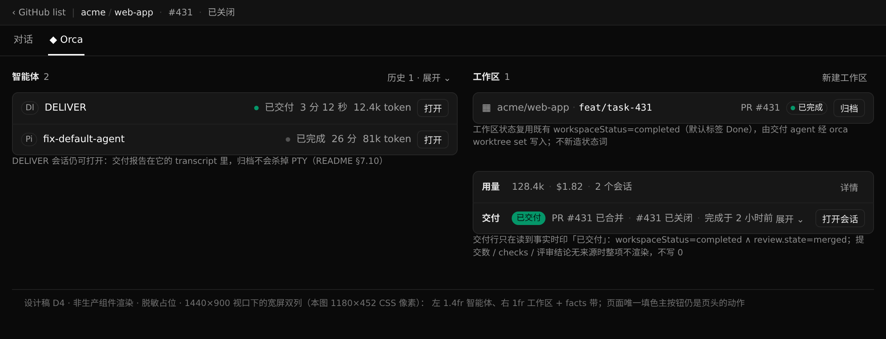
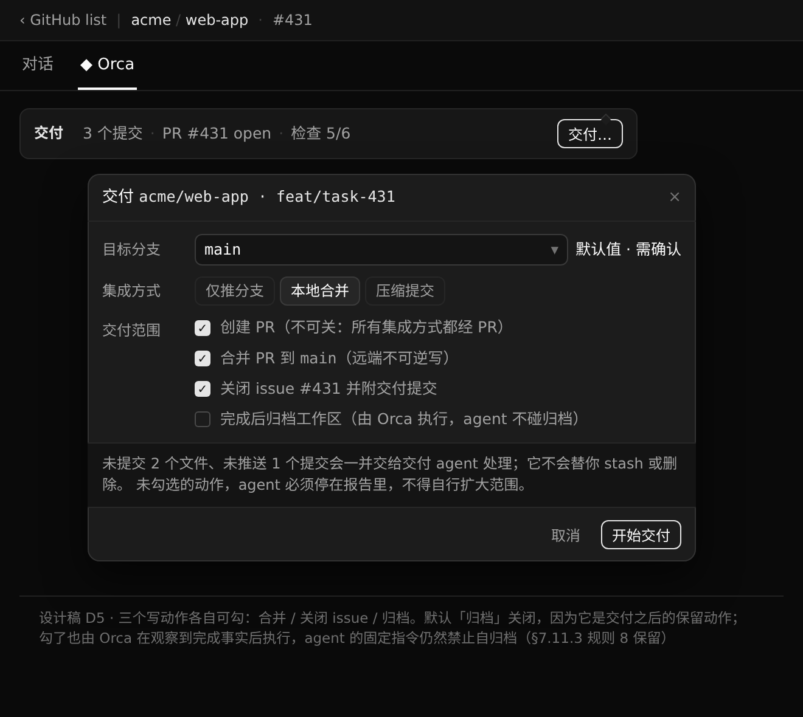
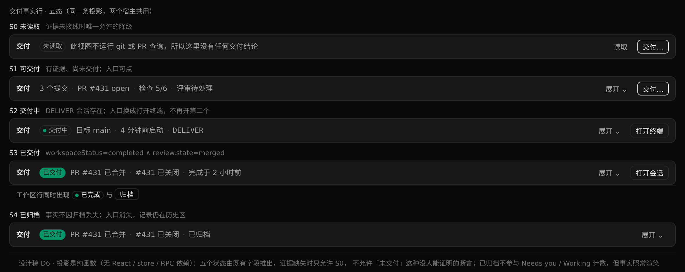

# 交付完成：合并、关闭 issue、状态化（技术方案）

状态：**已实现（S1–S5），真机验收未做**。方案与验收口径不变；落地清单、已执行的测试与仍缺的证据
见 [README §7.12.1–§7.12.3](README.md)。基线：`origin/main` @ `6e3d4bd7`（含 §7.11 交付入口与
§8.10 `taskRecords`）。
上位记录：[README.md](README.md) §7.11（交付入口）与 §7.4.2（面板版面）；本文是它的下一片，
不改 §7.11.3 规则 1–7，重写规则 8（归档归属，见 §3 D2）并关闭 §7.11.6 的两条路由缺口（D5）。
**D2 的机制已被 issue #49 改写**：归档不再由 renderer 的观察 hook 执行，而是交付 agent 报告后的
最后一步；下文原方案保留为决策记录，改写处标出。

## 0. 摘要

交付现在只做一件事：在目标工作区开一个 agent，把固定指令交出去。它**没有终点**——不合并、
不关 issue、不写任何状态，界面也读不出一份交付证据（`deliveryByWorktree: undefined`）。
所以"交付过"这件事在工作台上不可见，用户点完交付看不到任何收敛。

本方案把它变成一条**有终点的流水线**：

```text
点交付（勾选范围） → 交付 agent 读 skill → 验证 + 独立评审
                   → 经 PR 集成 →（勾选）合并 PR
                   →（勾选）关闭 issue 并附交付提交
                   → orca worktree set --workspace-status completed   ← 唯一的写入
                   → 三段报告 →（勾选）交付 agent 最后一步自己归档（issue #49）
界面：交付行从 [未读取] 变成 [已交付] PR #n 已合并 · #issue 已关闭；工作区行出现 ● 已完成
```

**不需要新 storage domain、不需要新 RPC/IPC、不需要 bump schema**：完成事实落在既有的
`workspaceStatus`（`orca worktree set` 已支持），PR merged / issue closed / 会话 / agent 结论
都从既有字段读。这是本方案最重要的取舍（见 §3 D3）。

## 1. 目标与非目标

### 1.1 目标（按操作者的三条，逐条可验收）

| # | 目标 | 本文落点 |
| --- | --- | --- |
| G1 | 点交付 → agent 自动开跑并执行交付 skill | 已有（§2.1），本方案补齐幂等与首条消息（D5、§5） |
| G2 | 交付包含：合并 PR、关闭 issue、归档 | §5 指令四阶段 + §3 D1/D2 的授权与归属 |
| G3 | 完成后 issue 的 Orca 页显示「已交付」，且重启/归档后仍在 | §4 投影 + §6 UI；持久性由 `workspaceStatus` 提供 |

### 1.2 非目标（本次不做，需单独授权）

- 部署、重启服务、发布；真实合并真实 PR、真实关 issue（测试与演练全部 mock）。
- GitLab / Linear / Jira 的状态写回：只有 GitHub 有写路径（`gh`），其余保持只读。
- 会话级用量归因、checks 明细、评审结论来源（M3 的剩余部分）：无来源时不渲染，**不猜**。
- 交付中会话的跨设备接管；多任务批量交付。
- Trae 启动参数的私有修复（环境侧的启动包装配置，见 D6）。

## 2. 现状与证据

### 2.1 已经成立的部分（不改）

| 事实 | 证据（`6e3d4bd7`） |
| --- | --- |
| 交付启动是既有链路：`launchAgentInNewTab` + 固定指令 + `submit-after-ready` | `lib/task-workbench/task-workbench-deliver-launch.ts:170-198` |
| 指令要求先读 `swarm/skills/worktree-delivery/SKILL.md`、跑测试、取独立评审、必须经 PR、禁止直推目标分支、禁止写主检出 | 同上 `:101-104` |
| 指令禁止 agent 自归档（issue #49 已改为勾选时由 agent 在报告后执行，见 §3 D2） | 同上 `:106`、`:111` |
| 一个投影服务两个宿主（事实行 + sidebar 右键） | `components/task-workbench/task-workbench-deliver-state.ts:170`（`projectTaskWorkbenchDeliver`） |
| 会话标记是 tab 的 `quickCommandLabel = 'DELIVER'` | `task-workbench-deliver-session.ts:28`；写入点 `lib/launch-agent-in-new-tab.ts:303` |

### 2.2 缺口（本方案要补的）

| 缺口 | 现状 | 证据 |
| --- | --- | --- |
| 合并 PR | 指令只要求"经 PR 集成"，没有 merge 步骤，也没有合并授权 | `task-workbench-deliver-launch.ts:103-104` |
| 关闭 issue | 完全缺失；实测一次交付的 PR 用 `Refs #39`，issue 保持 open | 同上（指令全文）+ 现场报告 |
| 归档 | **明确禁止** agent 执行（issue #49 后改为：勾选时由 agent 在报告后执行，见 §3 D2） | 同上 `:106`、`:111` |
| 完成状态 | 没有任何写入；没有可供读取的"已完成"事实来源 | 见下 |
| 交付证据接线 | `deliveryByWorktree` 恒为 `undefined`，交付行永远是 `未读取` | `hooks/use-task-workbench-view.ts:343` |
| issue 状态渲染 | `tracker.state` 传进视图后无人读 | `github-item-dialog.tsx:256` → `task-workbench-view.ts:196` |
| 幂等 | 结构化和 host-published 两条路由不携带 `quickCommandLabel` | §7.11.6 bound 1/2；`lib/structured-agent-session-provisional-tab.ts`、`lib/launch-agent-web-host-tab.ts` 全文无该字段 |

### 2.3 现场观察（为什么这不是假想缺口）

同一个工作区在 20 分钟内被启动了**两次**交付 agent（13:35、13:59），第二次的最终报告是
"PR #42 已合并、分支与 origin/main 相同、无可集成；issue #39 仍 open；归档是你的下一步"。
三个缺口同时出现：幂等没拦住第二次、指令没有关 issue、界面在这一切之后仍然没有任何交付状态。

## 3. 关键决策

### D1 交付范围由读者勾选，不由代码默认扩张

确认面在现有三项（目标分支 / 集成方式 / 交付后归档）之外，加**三个写动作的显式勾选**：
`创建 PR`（固定、不可关）、`合并 PR`、`关闭 issue #n`。默认：合并=开、关 issue=开、归档=关。

- **为什么**：合并与关闭 issue 是远端不可逆写；§7.11.3 规则 3 已经确立"人确认输入"的口径，
  合并只是同一类输入的延伸。未勾选的动作，指令必须 stop 并在报告里写明"未授权"。
- **被否**：默认全自动且不可关（首次误合并无法回滚，且没有二次确认）。
- **后果**：指令按勾选裁剪；三个勾的组合是验收矩阵的一部分（§8）。

### D2 归档归属：由交付 agent 在报告后执行（issue #49 改写）

原方案（已删除）：保留“agent 不归档”，把归档从 agent 的步骤挪到渲染层——勾了 `完成后归档` 时，
Orca 观察该工作区进入 `completed` 且交付事实成立，就执行 `worktree archive`（既有动作，只隐藏行、
不杀 PTY）。

为什么被改写：该意图只存在于 renderer 内存，消费者只有挂在 issue 详情 → Orca tab 的 hook，
弹窗一关、renderer 一重启即丢；从 sidebar 发起的交付根本没有消费者；观察条件还要等 agent 跑完
几分钟，那时弹窗早已关闭。实测（PR #48 交付）勾选后未归档，也没有任何提示。

现行方案：`archiveAfter=true` 时指令追加第 8 步，**先报告、后归档**——
`orca worktree archive --worktree <self> --json`；归档失败只写进报告，不重试、不判交付失败。
`archiveAfter=false` 保持原句（agent 不归档、由人点）。当初两条反对理由复核后不再成立：
archive 只隐藏行、不杀 PTY（`cli/specs/worktree-archive.ts`），Restore / `worktree unarchive` 一键恢复；
`scripts.archive` 那个 120s 死线是 `worktree rm` 的前置门，不是 `worktree archive` 的。

- **被否**（不改）：补持久化字段 + 全局消费者。做得到，但把一个执行者自己就能完成的事
  变成新的存储与调度面（issue #49 已把这条记为“同源缺陷但本次不做”）。
- **后果**：归档依赖交付会话自己走到第 8 步；agent 中途停止时工作区保留，人仍可从工作区行归档。
  同一改动删除了 `lib/task-workbench/task-workbench-deliver-archive-intent.ts` 与
  `hooks/use-task-workbench-deliver-archive.ts`，因此“重启丢意图”的缺口一并消失。

### D3 完成事实 = 既有 `workspaceStatus`，写入者是交付 agent，写入路径是既有 CLI

指令的完成状态写入步骤（勾选归档时其后还有第 8 步归档）：

```bash
orca worktree set --worktree <self> --workspace-status completed \
  --comment "delivered: PR #<n> merged as <sha>; issue #<n> closed"
```

- **为什么**：`worktree set` 已支持 `--workspace-status` / `--comment`
  （`cli/specs/core.ts:158-181`、`cli/handlers/worktree.ts:268-282`），因此**不需要新 IPC**；
  工作区状态是持久数据，重启、归档、删除后仍可读；工作区行已经在渲染该标签
  （`TaskWorkbenchWorkspaces.tsx:155`），默认状态里 `completed` 已存在
  （`shared/workspace-status-defaults.ts`）。
- **被否**：新增 `delivery` 持久字段（要么扩 `Worktree`/`worktreeMeta` + 一个 RPC 参数 + CLI flag，
  要么进 `taskRecords`——而 `taskRecords` 明确不存运行态，`shared/task-records-types.ts:13`）；
  把完成事实写进 `comment` 再解析（字符串协议，脆弱且不可查）。
- **代价（写下来而不是掩盖）**：工作区状态是**用户数据**，手工把列拖到 Done 也会读成 `completed`。
  所以「已交付」不能只靠它，必须叠加 `review.state === 'merged'`（D4）。

### D4 「已交付」= 完成状态 ∧ PR merged；issue 关闭是事实项，不是判定条件

| 判定 | 条件（全部来自既有字段） |
| --- | --- |
| `已交付` | 目标工作区 `workspaceStatusId === 'completed'` **且** 该工作区 `review.state === 'merged'` |
| `交付中` | 存在 `DELIVER` 会话（D5 补齐后三条路由都成立）且未满足上一行 |
| `未读取` | 没有任何证据读数（保持现状的降级，**不是**"未交付"） |
| `已归档` | `isArchived === true`；事实照常渲染，入口消失 |

- **为什么**：两个字段都已在 store 里（`shared/dashboard-snapshot.ts:50-52`、`:75-77`），
  不需要 PR 查询 RPC；`issue closed` 在本地任务上不存在、在 PR 页上指的又是 PR 自己，
  所以它只能是一行事实，不能当判定条件。
- **被否**：只按 issue closed 判定（PR 先合并、issue 由人晚关，会长期显示未交付）；只按
  `completed` 判定（手工拖列即冒充已交付）。
- **不做**：第三个状态词。UI 用「已交付」（交付行读者词）与既有的「已完成/Done」（工作区状态标签），
  不新增词汇（§7.4.3）。

### D5 幂等：把 `DELIVER` 标记补齐到所有路由，不引入第二个"会话存在"来源

在 structured-native-chat 的 provisional tab 与 host-published 的启动参数里携带
`quickCommandLabel`（§7.11.6 bound 1/2 的修法）。

- **为什么**：§7.11.5 D2 已经把"会话存在"收敛成一个判据；再加一个持久字段等于第二个事实来源。
- **被否**：新增持久 `deliverySession` 字段（与 D3 语义重复，且要扩 schema）。
- **已知残余**：用户重命名交付 tab 仍会丢标记（bound 4），保留为已记录缺口，不在本次修。

### D6 Trae 启动参数不属本方案

`traecli -c` 是 `--config <key=value>`，位置参数才是 `[PROMPT]`。环境侧给 Trae agent 配的启动包装把整段 sh 脚本塞进 `-c`，于是包装里的占位 token 变成了 PROMPT、交付指令只能作为第二条消息补进去。修复在私有配置里，需单独授权，本文只记录"交付指令必须是会话的第一条消息"这条验收（§8 的 A5）。

## 4. 状态模型与数据流

```text
store（权威）                            投影（纯函数）                     UI
─────────────────────────────────      ───────────────────────────       ───────────────────────
worktreeMeta.workspaceStatusId   ─┐
dashboard-snapshot.review.state  ─┼─→  projectTaskWorkbenchDeliver(v)  ─→ 交付行 / 入口动作
agent rows（DELIVER 标记）        ─┤      → state + action               工作区行状态 chip
worktreeMeta.isArchived          ─┤
view.tracker.state               ─┘      （issue 状态只做事实行，不进判定）
```

- 投影保持纯函数：不 import React / store / RPC / `git`，边界测试已经钉住这一点
  （`task-workbench-import-boundary.test.ts`）。
- 无证据时只允许 `evidence-not-read`，禁止输出"未交付"。
- 已归档工作区不参与 Needs you / Working 计数（§7.10 不变），但交付行照常渲染事实。

## 5. 交付指令：四个阶段与停止条件

固定指令（英文、代码持有，不本地化）在新方案下变成：

1. **读 + 验证 + 评审**（不变）：读 `worktree-delivery` skill，跑相关测试，看真实 diff，取独立评审。
2. **集成（不变）**：只经 PR 集成，任何模式都不直推目标分支、不写主检出。
3. **合并（勾选时）**：`gh pr merge <n> --merge|--squash|--rebase`；随后核验 PR 状态为 `merged`
   且目标分支 HEAD 前进。检查不过、有冲突、或需要人工批准时：**停在这里报告**，不重试合并。
4. **关闭 issue（勾选时、且任务有 tracker）**：`gh issue close <n> --comment "delivered in <sha> via PR #<n>"`；
   PR 已用 `Closes #n` 自动关闭时只核验，不再重复关闭。
5. **标记完成（必做）**：`orca worktree set --worktree <self> --workspace-status completed --comment "…"`。
6. **报告**：已完成 / 未完成 / 未授权三段分开写；不删、不停终端。
7. **归档（勾选时）**：报告写完之后、作为最后一步执行 `orca worktree archive --worktree <self> --json`；
   失败只在报告里说明，**不重试、不把交付判成失败**（issue #49）。未勾选时这一步不存在，
   指令明确要求不归档、由人点。

**停止条件**：任何一步失败即停，报告里必须写明"哪些已发生"，不得继续执行后续写动作；
不得用 `--force`、不得改目标分支保护、不得替用户 stash/reset/clean（沿用
`worktree-delivery` §1–§3 与 README §7.11.3 规则 6）。

## 6. UI 规格

### 6.1 三张图（HTML/CSS 渲染的设计稿，非生产组件渲染）



**D4 · 已交付的 issue 详情**（1180×452 CSS 像素）。左列 Agents、右列 Workspaces + facts 带；
交付行 `[已交付] PR #431 已合并 · #431 已关闭 · 完成于 2 小时前`，右端 `打开会话`；
工作区行 `● 已完成` + `归档`；页头状态 `已关闭`。



**D5 · 确认面**（660×590 CSS 像素）。在 §7.11.2 D2 的三项之上加"交付范围"：
创建 PR（固定）/ 合并 PR / 关闭 issue / 完成后归档。主按钮仍是 outline。



**D6 · 交付行五态**（1180×470 CSS 像素）。S0 未读取 → S1 可交付 → S2 交付中 → S3 已交付 →
S4 已归档。同一行五种形态，证明"状态不靠新词、只靠既有事实"。

### 6.2 逐元素规格

| 元素 | 位置 | 规格 | test id | i18n |
| --- | --- | --- | --- | --- |
| 状态签 | 交付行，标签之后 | 12px，`已交付` 用 accent 药丸；`交付中` 带 working dot；`未读取` 保持中性描边 | `task-workbench-delivery-state` | `TaskWorkbenchDeliver.state.*` |
| 事实项 | 状态签之后 | 12.5px muted，`·` 分隔；**无来源的整项不渲染** | `task-workbench-delivery-facts` | `TaskWorkbenchDeliver.facts.*` |
| 入口动作 | 交付行右端 | 已交付 → `打开会话`；交付中 → `打开终端`；已归档 → 不渲染 | `task-workbench-deliver-action` | 既有 |
| 工作区状态 chip | 工作区行右端 | 复用 `workspaceStatusLabel` + 色点（8px 圆角面，12px） | `task-workbench-workspace-card` | 数据，不翻译 |
| 归档 | 工作区行右端 | 24px ghost 按钮，与 sidebar 右键同一动作 | `task-workbench-workspace-archive` | `TaskWorkbenchWorkspaces.archive` |

### 6.3 窄屏（< ~900px）

单列，牺牲序不变（Workspaces → Agents → facts）。交付行允许换行成两行，事实项逐条排版；
**不允许**折叠成 `…`（会被读成"还有未知"），也不允许隐藏状态签。

### 6.4 状态 × 界面矩阵

| 状态 | 交付行 | 入口 | 工作区行 | 归档按钮 | 备注 |
| --- | --- | --- | --- | --- | --- |
| `未读取` | `[未读取]` + 一句原因 | `交付…` | 状态 chip（若有） | 有 | 证据未接线时的唯一降级 |
| `可交付` | 事实项（有则显示） | `交付…` | — | 有 | 有 Working agent 时入口禁用并给理由 |
| `交付中` | `[交付中] 目标分支 · 启动时长` | `打开终端` | — | 有（不阻止） | 第二次点击 reveal，不新建 |
| `已交付` | `[已交付] PR merged · issue closed · 完成于 …` | `打开会话` | `● 已完成` | 有 | 勾了归档时由交付 agent 在报告后执行 |
| `已归档` | 同上，末尾 `已归档` | 不渲染 | `Archived` | 不渲染 | 记录在历史区，事实不丢 |

## 7. 实施切片

每片独立可回退；前三片完成后功能即成立，后两片是边界与体验。

> 落地状态：S1–S5 全部实现（分支 `feat-task-workbench-pr-issue-7.12`），实现与测试清单见
> [README §7.12.1](README.md)。下表保留为当初的切片定义。

| 片 | 改动 | 文件 | 测试 |
| --- | --- | --- | --- |
| **S1 投影** | 新增两个状态（`completed` / `delivering` 用既有）与 `已交付` 事实项；判定读 `workspaceStatusId` + `review.state` | `task-workbench-deliver-state.ts`、`task-workbench-view.ts`（`tracker` 注释与可选事实字段） | `task-workbench-deliver-state.test.ts`（每个 fixture 只输出 `{key,fallback}`；证据缺失只出 S0） |
| **S2 指令 + 确认面** | 四阶段指令、停止条件、三项勾选、i18n | `lib/task-workbench/task-workbench-deliver-launch.ts`、`task-workbench-deliver-confirm.tsx`、六语 `locales/*.json` | `task-workbench-deliver-launch.test.ts`（合并/关闭/标记三句、未勾选不出现、勾选时归档排在报告之后）、`task-workbench-deliver-confirm.test.tsx`（三项默认值、未勾选裁剪） |
| **S3 事实接线** | 用 `review` 填交付证据、读 `tracker.state`、渲染状态签；关闭后使 item 详情缓存失效 | `hooks/use-task-workbench-view.ts`、`TaskWorkbenchDelivery.tsx`、`github-item-dialog-orca-tab.tsx` | `use-task-workbench-view.test.tsx`（merged/closed/open 三态）、`TaskWorkbenchDelivery.deliver.test.tsx`（五态渲染 + 无来源不渲染） |
| **S4 归档执行** | ~~观察到 `completed` ∧ 勾选过归档 → 执行既有 archive~~ → **issue #49 改写**：勾选时指令第 8 步 `orca worktree archive`，先报告后归档，失败只提示 | `lib/task-workbench/task-workbench-deliver-launch.ts`；已删意图模块与观察 hook | `task-workbench-deliver-launch.test.ts`（勾选/未勾选、报告前/后顺序、失败不重试不判失败） |
| **S5 路由标记** | 结构化 provisional tab 与 host-published 启动参数携带 `quickCommandLabel` | `lib/structured-agent-session-provisional-tab.ts`、`lib/launch-agent-web-host-tab.ts`、`lib/launch-agent-in-new-tab-structured.ts` | 三条路由各一条 marker 用例；`task-workbench-deliver-launch.test.ts` 已有 (a)(b) 用例扩展到 structured/host 路由 |

验证命令（每片按影响面选，不跑全量）：

```bash
cd orca && node node_modules/vitest/vitest.mjs run --config config/vitest.config.ts \
  src/renderer/src/components/task-workbench src/renderer/src/lib/task-workbench --maxWorkers=2
```

本文档本身不改 `swarm/` 代码，因此不产生 Python 测试范围；若 S1–S5 落地后触及 `swarm/` 的
脚本或门禁，再按 `tests/run_blast.sh --range` 选择。

## 8. 验收矩阵

| # | 需求 | 断言 | 证据层级 |
| --- | --- | --- | --- |
| A1 | G1 | 点交付 → 目标工作区出现 `DELIVER` 会话，指令为完整四阶段 | 单测（指令文本）+ 真机手工 |
| A2 | G2 | 勾选合并时指令含 `gh pr merge`，未勾选时**不含**且要求 stop | 单测 |
| A3 | G2 | 勾选关 issue 时指令含 `gh issue close <n>`，且编号取自视图而不是猜 | 单测 |
| A4 | G2 | 勾选归档 → 指令含 `orca worktree archive --worktree <self>` 且在报告段之后；未勾选 → 不含任何归档命令且仍要求“不归档” | 单测（§3 D2 改写后；回归 §7.11.3 规则 8） |
| A5 | G1 | 结构化与 host-published 路由也写 `quickCommandLabel`，第二次点击 reveal 不新建 | 单测（三条路由） |
| A6 | G3 | `completed` ∧ `merged` → 交付行 `已交付`；缺任一 → 不出 `已交付` | 单测 + fixture 渲染 |
| A7 | G3 | `未读取` 不渲染成"未交付"；无 checks 时不渲染 `0/0` | 单测 |
| A8 | G3 | 归档后交付行仍显示 `已交付`，入口消失 | 单测 + fixture 渲染 |
| A9 | G2 | 完成后工作区状态为 `completed`（写入路径 = 既有 `worktree set`） | 单测（指令）+ 真机手工 |
| A10 | D2 | 勾选归档时，归档是交付 agent 的最后一步；失败只在报告里说明，不重试、不判交付失败；未勾选时不归档 | 单测（issue #49） |

## 9. 风险与回退

| 风险 | 处理 |
| --- | --- |
| 勾了合并但目标分支有保护/检查不过 | 指令 stop 并报告，不降级为直推、不改保护 |
| 误关 issue | 需要显式勾选 + 编号来自视图；关闭后仍可在 GitHub 重开（不在 Orca 做二次写） |
| 归档过早导致报告没看 | 归档是 agent 自己的最后一步（先报告、后归档），且 archive 不杀 PTY（§7.10）；`unarchive` 可恢复 |
| 「已完成」被手工误用 | `已交付` 额外要求 `review.state === 'merged'`；单一 `completed` 不构成已交付 |
| 交付会话中途停止，归档没执行 | 工作区保留原状，人可从工作区行一键归档；只是少了自动性 |
| Trae 首条消息不是交付指令 | 本方案不修（D6）；A5 的验收在终端路由上先行，Trae 修复单独授权 |

**回退**：三个勾默认关掉即回到现有行为；完成事实是工作区状态，用户可改回；没有 schema 变更，
不需要数据迁移或恢复步骤。

## 10. 未包含与需单独授权

1. 生产代码落地（`orca/` renderer + i18n）与测试；本文只有文档与三张设计稿。
2. 部署、重启、发布；用户在真实仓库上验证一次合并 + 关闭 issue。
3. 环境侧私有 Trae 启动参数的修复（D6）。
4. 其他 tracker 的关闭写回（GitLab/Linear/Jira）。
5. checks / 评审结论 / 提交数的真实来源（M3 剩余部分）。

## 11. 对既有决策的改写

| 位置 | 原文 | 新文 | 依据 |
| --- | --- | --- | --- |
| §7.11.3 规则 8 | 归档最后仍由人点（agent 不归档） | 勾选时由交付 agent 在报告后执行；未勾选时不归档 | 归档不杀 PTY、可 `unarchive`；renderer 意图不跨面板/重启（issue #49） |
| §7.11.6 bound 1 | structured 路由不写 `quickCommandLabel`，第二次激活会再启动 | 本方案补齐（S5） | D5 |
| §7.11.6 bound 2 | host-published 路由无 `quickCommandLabel` | 已收窄（S5）：标记写到镜像的本地 tab 行，host wire 仍不携带 | D5 |
| §7.11.1 结论 | 归档是交付之后的保留动作 | 不变；但"交付完成"现在有可读事实，归档可以被自动化 | D2/D3 |

## 12. 证据缺口（本方案自己证明不了的事）

- 三张图是 HTML/CSS 渲染稿（源文件在 `ui/src/design-deliver-20261120-*.html`，渲染命令见
  `render-design-mockup.mjs` 文件头），**不是生产组件渲染、不是真机截图**；图内数据是脱敏占位
  （`acme/web-app`、`#431`），不含真实主机、会话或用量。
- 图证明不了：真实 `gh pr merge` / `gh issue close` 的权限与分支保护行为、真实归档 hook 的耗时、
  locale 切换后的排版、以及三条启动路由在真机上的 marker 持久化。
- A1/A9 的"真机手工"条目仍未做：实现后跑的是单测（清单见 README §7.12.2），没有一次真实交付演练。
- 实现新增的缺口（如实记录）：host-published 的标记只写本地镜像行，host wire 不携带，对端设备读不到；
  ~~S4 的归档意图不跨应用重启~~（issue #49 删除该实现，改为 agent 自己归档）；关闭 issue 后没有主动失效 item 详情缓存；
  es/fr/ja/ko 的新文案是英文回退。
- 实现补了四张 harness 渲染图（`ui/impl-20261120-delivered*.png`、`impl-20261120-deliver-confirm.png`，
  见 README §7.12.2）：它们是生产组件的 CDP 截图，不是设计稿，也仍不是真机截图。
