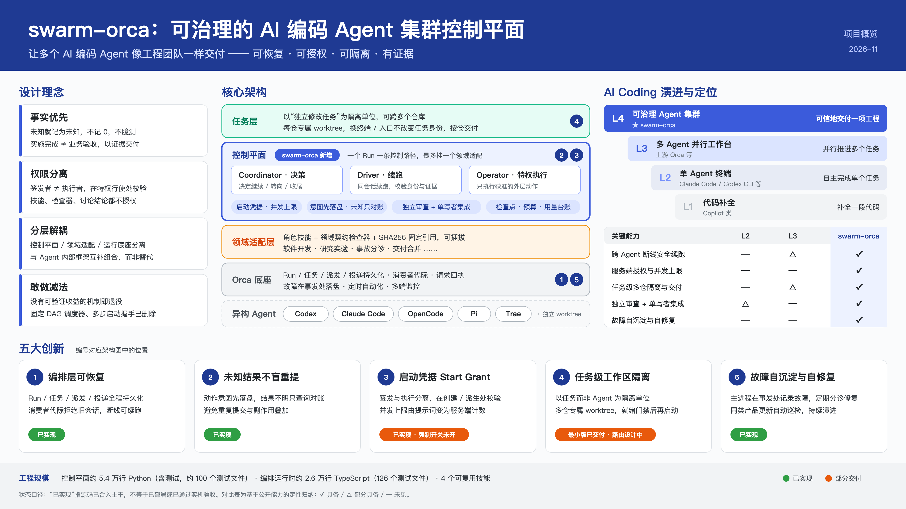
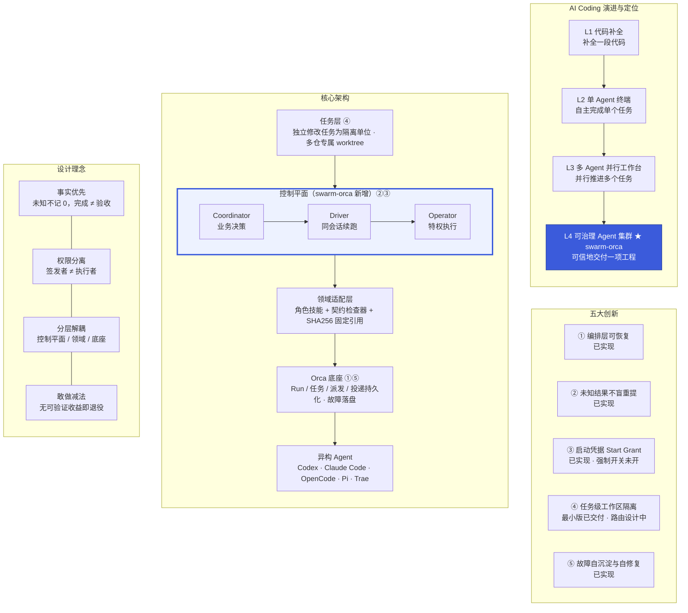

# swarm-orca 项目概览图

一页概览，突出设计理念、核心创新与在 AI Coding 方向的定位。本图是介绍材料，
不构成部署、启动 Agent 或任何权限授权；各能力的实现状态以对应设计文档为准。

| 文件 | 用途 |
| --- | --- |
| [swarm-orca-overview.svg](swarm-orca-overview.svg) | 正式版矢量图（1920×1080），可编辑、可直接嵌入文档 |
| [swarm-orca-overview.png](swarm-orca-overview.png) | 由 SVG 以 2 倍分辨率渲染的位图，用于 PPT / 飞书 |
| 本文 Mermaid 源码 | 结构草稿，便于快速改内容后重新排版 |



## Mermaid 源码



## 内容依据

| 图中内容 | 依据 |
| --- | --- |
| 分层、单一控制路径、领域适配接入点 | [入口选择](../entry-paths.md) §3–§4 |
| ① 编排层可恢复、② 未知不盲重提 | 原生 Delivery / consumer generation / mutation receipt；[TUI 续跑](../../coordinator-tui.md) |
| ③ 启动凭据及其状态 | [start grant](../design/start-grant.md) §4.0（`START_GRANT_REQUIRED` 仍为 `false`） |
| ④ 任务级工作区隔离及其状态 | [任务工作区设计](../design/task-workspaces.md)、[稀疏任务工作区开发计划](../design/sparse-task-workspace/development-plan.md) §7 |
| ⑤ 故障自沉淀 | [故障沉淀设计](../design/issue-sedimentation.md)（M1–M8 已实现）、[Release radar](../../release_radar/README.md)、[incident-triage](../../skills/incident-triage/SKILL.md) |
| 敢做减法 | [Supervisor 退役记录](../supervisor.md)、start grant 对旧握手的替代 |
| 工程规模 | 2026-11-20 对本仓库 `main` 的统计：`swarm/` 下 `*.py` 约 53.7k 行（含测试，约 100 个测试文件）；`orca/src/main/runtime/orchestration` 非测试 TS 约 26.4k 行、126 个 `*.test.ts` |

状态口径：“已实现”指源码已合入主干，不等于已部署或已通过实机验收。L2 / L3 对比是基于公开能力的
定性归纳，不是逐项评测结果。

## 重新生成 PNG

修改 SVG 后，用 Chrome 无头模式按 2 倍分辨率渲染：

```bash
"/Applications/Google Chrome.app/Contents/MacOS/Google Chrome" --headless=new --disable-gpu \
  --hide-scrollbars --force-device-scale-factor=2 --window-size=1920,1080 \
  --screenshot="$PWD/swarm-orca-overview.png" "file://$PWD/swarm-orca-overview.svg"
```
